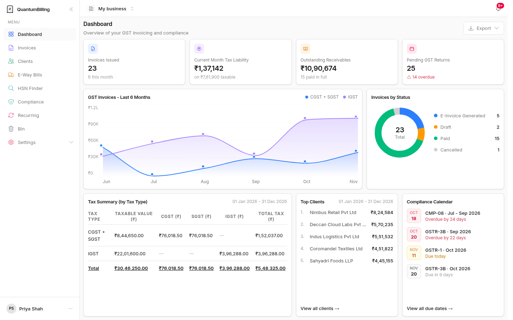
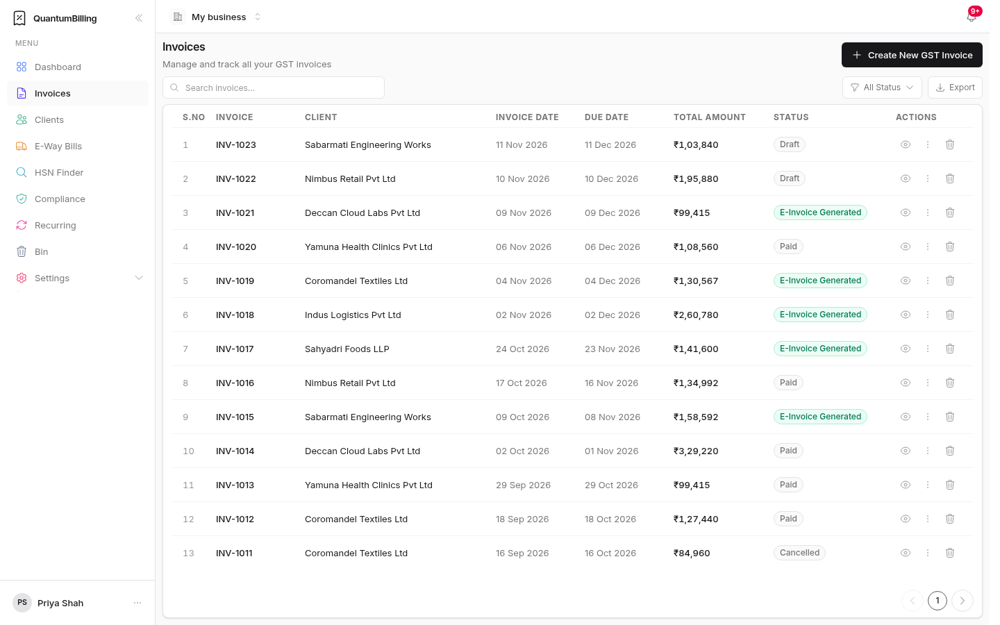
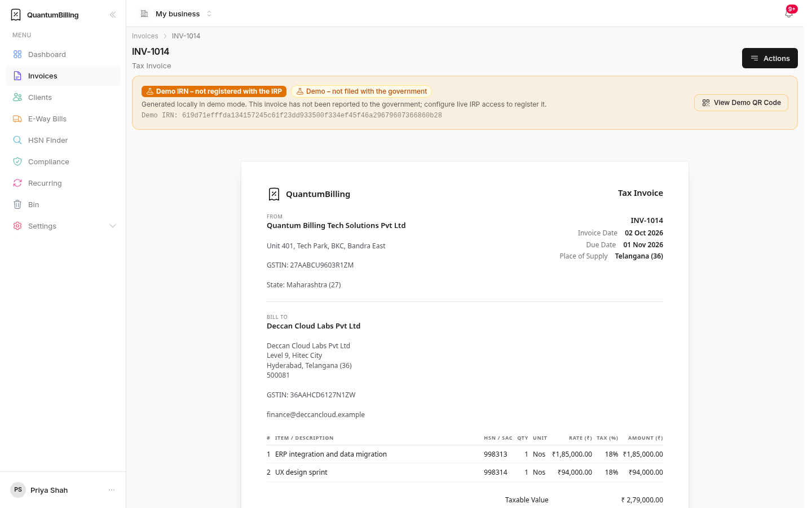
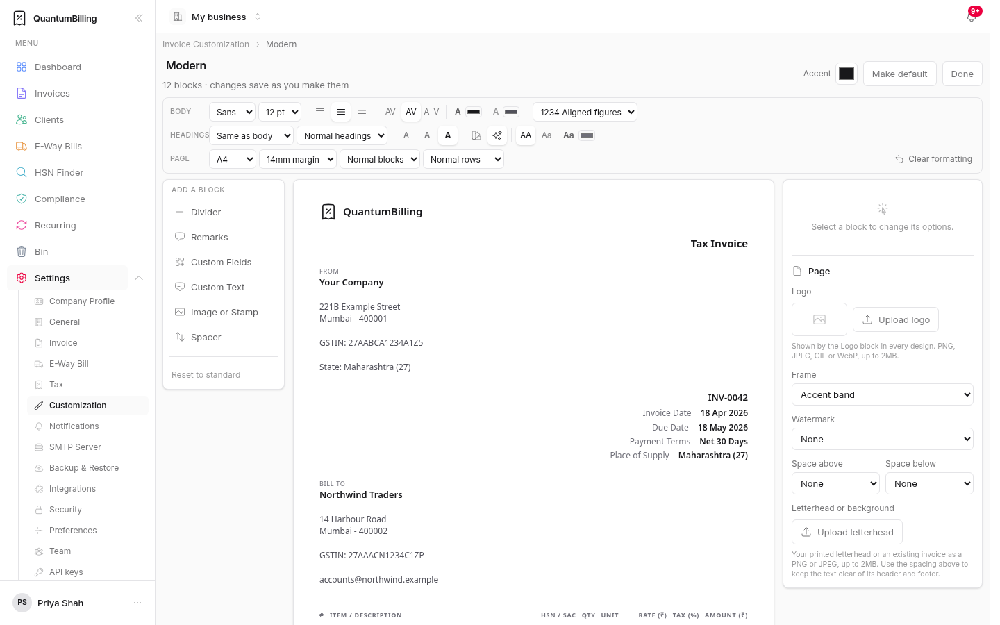
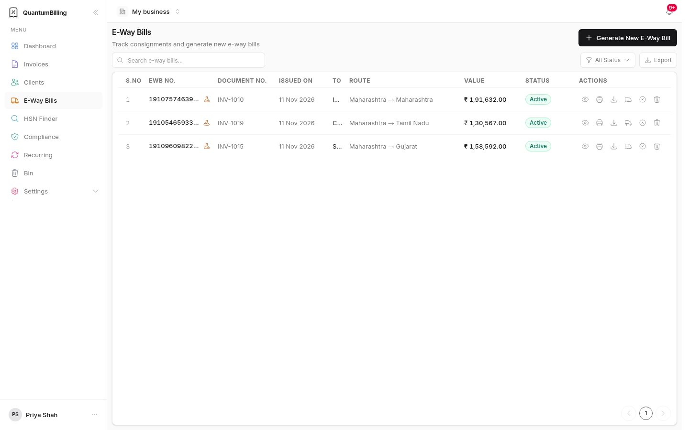
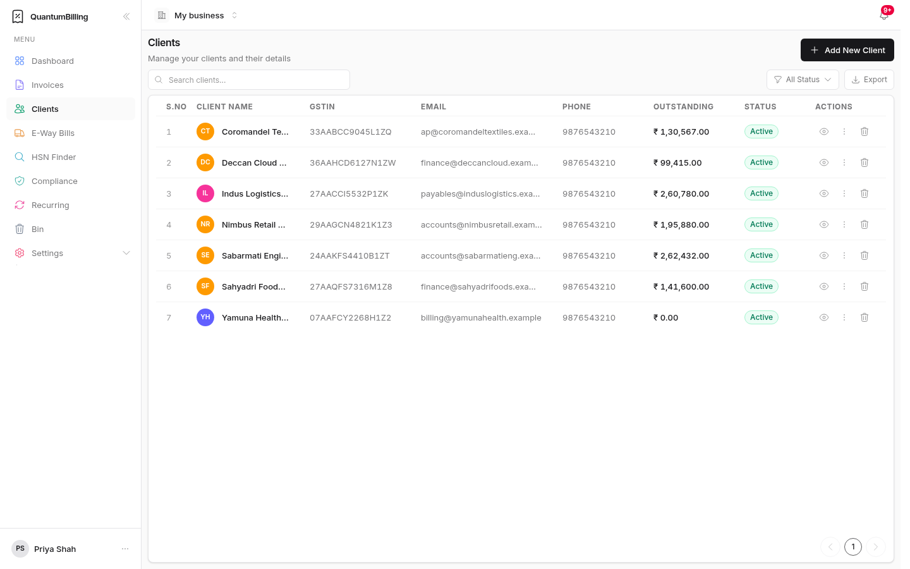
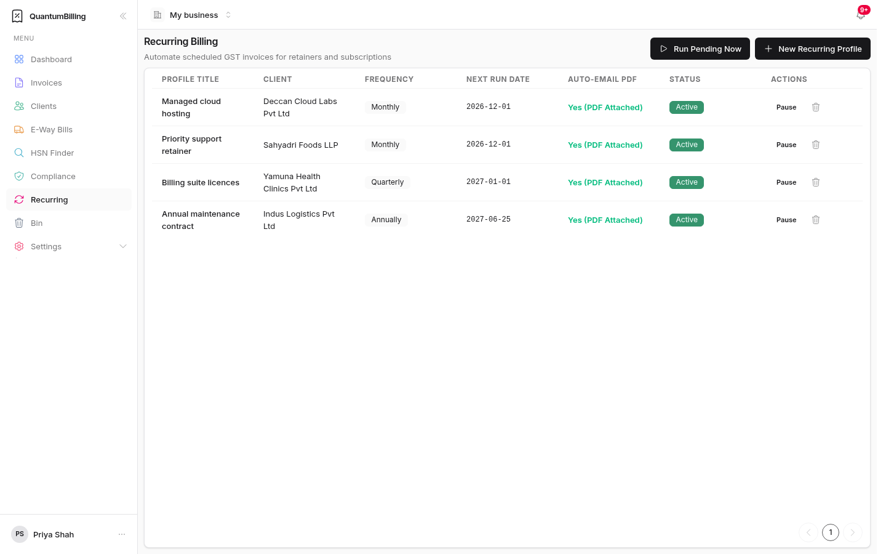
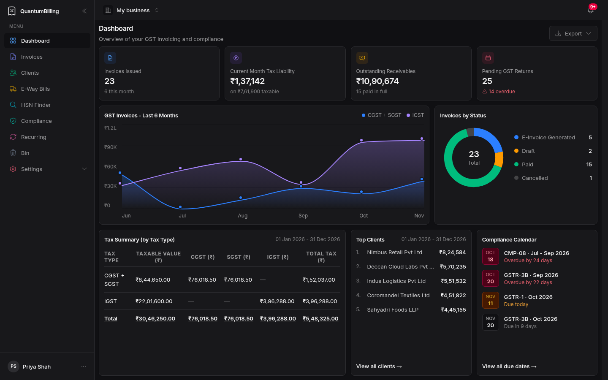

# QuantumBilling



**Version 0.1.0** · MIT License · Elixir 1.18 / OTP 27 · Phoenix 1.8 · PostgreSQL 16

QuantumBilling is a billing application for businesses, built with Phoenix LiveView. It handles clients, invoices under India GST or VAT, credit and debit notes, e-invoice registration, e-way bills, recurring billing, payment links, the dashboard and exports, and compliance reminders.

One installation serves many businesses. Each business keeps its books in its own PostgreSQL schema (`biz_1`, `biz_2`, …), while accounts, memberships and background jobs are shared in `public`.

**Why it matters.** Small and medium businesses in India have to issue GST-correct invoices, register e-invoices and raise e-way bills. QuantumBilling gives them a free, open-source way to do that on a server they control, with their records kept in their own database.

## At a glance

| | |
| --- | --- |
| **Version** | **v0.1.0**, set by `version` in [`mix.exs`](mix.exs). See [Versions](#versions). |
| **Runtime** | Elixir 1.18.3 / Erlang OTP 27, Phoenix 1.8, LiveView 1.2, PostgreSQL 16, Oban 2.24 |
| **PDF output** | Headless Chromium (or Chrome) on the server |
| **API** | REST under `/api/v1` with scoped API keys. OpenAPI document 1.2.0 in [`docs/openapi.json`](docs/openapi.json) |
| **Deployment** | One OTP release behind a TLS reverse proxy. It runs the web app and the job queues, and needs no Redis or worker service. |
| **Licence** | [MIT](LICENSE) |

## Features

- **Invoicing.** Each business charges **India GST** (CGST/SGST/IGST from the place of supply) or **VAT** (UAE, Gulf states, UK, EU), and bills in INR, AED, SAR, QAR, GBP, EUR or USD. Invoices get numbered series, snapshots, statuses and a Bin with restore.
- **Adjustments.** Credit and debit notes follow the regime of their invoice.
- **India compliance.** IRP e-invoice registration, e-way bills (Form GST EWB-01 with Part-B legs), the GSTR-1 export, an HSN/SAC finder, and a filing calendar with your own reminders.
- **Getting paid.** Email delivery with PDF, a public invoice page, and Razorpay payment links or a direct UPI QR, all for INR invoices.
- **Recurring billing.** Profiles generate invoices on a daily schedule.
- **Invoice designer.** Starting designs, layout blocks, letterheads, watermarks, payment details and printable custom fields.
- **Custom fields.** Eleven field types on clients, invoices, invoice lines, credit notes, e-way bills and recurring profiles. They can show as list columns or filters, print on invoices, and pass through the API.
- **Teams and security.** Owner and Staff roles, invitations, and optional TOTP two-factor authentication, which an owner can make mandatory for everyone. Also an audit trail, security alert emails, a nonce CSP and rate limits.
- **Integrations.** A REST API with idempotent writes, signed outgoing webhooks, and Google Calendar sync for compliance dates.
- **Data.** A dashboard with a sales register and tax-summary CSV exports, and a per-business JSON backup and restore.

Some integrations are simulated until you configure them. IRP registration runs in simulation by default, and e-way bills are demo numbers until `NIC_EWB_API_URL` is set. Both are labelled as demo wherever they appear. See [Current limits](#current-limits).

## Screenshots

| | |
| --- | --- |
| [](docs/assets/screenshots/invoices.png) | [](docs/assets/screenshots/invoice.png) |
| **Invoices.** Every invoice with its client, dates, total and status, plus search, a status filter and CSV export. | **Invoice.** A paid tax invoice. The banner marks its IRN as a demo, not registered with the IRP. |
| [](docs/assets/screenshots/designer.png) | [](docs/assets/screenshots/e-way-bills.png) |
| **Invoice designer.** Type, spacing, page size, layout blocks, logo, frame, watermark and letterhead, with a live preview. | **E-way bills.** Bills raised from invoices, with route, value and status. The beaker marks a demo bill. |
| [](docs/assets/screenshots/clients.png) | [](docs/assets/screenshots/recurring.png) |
| **Clients.** GSTIN, contact details and the outstanding amount for each client. | **Recurring billing.** Monthly, quarterly and annual profiles that raise invoices and email the PDF. |

Every page also has a dark theme, which follows the system setting or the choice in Settings → Preferences:



The screenshots show release v0.1.0 with fictional demo data. The IRNs and e-way bill numbers in them are demo results, and nothing was filed.

## Run locally

You need Elixir 1.18.3 / Erlang OTP 27, PostgreSQL 16, and Chromium for PDF generation. The project declares Elixir `~> 1.17`; the [stack guide](docs/tech-stack.md) explains the pinned versions.

Copy the template **only if `.env` does not already exist**:

```bash
cp .env.example .env
```

In `.env`:

- Set `DB_USERNAME` and `DB_PASSWORD` for PostgreSQL.
- Fill `SECRET_KEY_BASE`, `TOTP_ENCRYPTION_KEY` and `SECRETS_ENCRYPTION_KEY`, generating a separate value for each with `openssl rand -base64 48`.
- On an existing installation, keep the encryption keys you already have.

```bash
mix deps.get
mix ecto.create
mix ecto.migrate
mix assets.setup
mix assets.build
mix phx.server
```

Open [http://localhost:4000/users/log-in](http://localhost:4000/users/log-in). The [setup guide](docs/getting-started.md) covers registration and seeding.

`mix ecto.migrate` applies the public migrations, then the tenant migrations to every business schema. Read the [database guide](docs/database.md) before you migrate an existing installation.

### Seed login

No password is shared or hard-coded. Set these in your local `.env` before seeding:

```dotenv
SEED_ADMIN_EMAIL=demo@example.test
SEED_ADMIN_USERNAME=demo
SEED_ADMIN_PASSWORD=
```

Choose your own password (8–72 characters). Sign in with the **email and password**; the username is not used to sign in.

Seeding confirms a newly created account directly. It does not reset the password of an account that already exists. The [setup guide](docs/getting-started.md#seed-account-and-login) gives the seed commands and what happens when you rerun them.

## Contributing

QuantumBilling is part of **Winter of Code Social 2026**, and first-time contributors are welcome.

1. **Get the app running** with [Run locally](#run-locally) above.
2. **Read [CONTRIBUTING.md](CONTRIBUTING.md)**, especially the [Winter of Code Social section](CONTRIBUTING.md#winter-of-code-social-2026) and the [AI policy](CONTRIBUTING.md#ai-policy).
3. **Pick an issue:**
   - [Beginner issues (`level 1`)](https://github.com/phravins/QuantumBilling/issues?q=is%3Aissue+is%3Aopen+label%3A%22level+1%22)
   - [All open issues](https://github.com/phravins/QuantumBilling/issues)
4. **Comment on the issue to ask for it**, and start once it's assigned to you.

Questions go in the QuantumBilling post in **#find-a-project** on the [Code Social Discord](https://discord.gg/MSTNyRSPYW). To report a security problem, follow [Reporting a vulnerability](CONTRIBUTING.md#reporting-a-vulnerability) instead of opening an issue.

## Deploy

QuantumBilling ships as an OTP release. Build it with the same Elixir/OTP versions, on the same OS family as the server:

```bash
mix deps.get --only prod
MIX_ENV=prod mix assets.deploy
MIX_ENV=prod mix release
```

On the server, set the environment, back up the database, run the migrations once, then start the release:

```bash
_build/prod/rel/quantum_billing/bin/migrate
_build/prod/rel/quantum_billing/bin/server
curl --fail http://localhost:4000/health     # {"status":"ok","database":"ok"}
```

| Variable | Needed | Purpose |
| --- | --- | --- |
| `DATABASE_URL` | Yes | PostgreSQL connection URL |
| `PHX_HOST` | Yes | Public host name. It must match the address browsers use, or the LiveView socket is refused. |
| `SECRET_KEY_BASE` | Yes | Signs and encrypts sessions and tokens |
| `TOTP_ENCRYPTION_KEY` | Yes | Encrypts stored authenticator secrets |
| `SECRETS_ENCRYPTION_KEY` | Yes | Encrypts stored SMTP and provider secrets, and webhook payloads |
| `TRUSTED_PROXIES` | Behind a proxy | Proxy addresses allowed to supply the client IP |
| `DATABASE_SSL` | Remote database | `true` encrypts and verifies the database connection |
| `SMTP_*` | For mail | Confirmation, reset, invitation and invoice email. Production has no dev mailbox. |
| `PORT` | No (4000) | HTTP port. Reach it through the proxy only. |

Keep these in the host's secret manager or service environment, never in the repository or a file inside the release.

The proxy terminates TLS, overwrites `x-forwarded-proto` and `x-forwarded-for`, and passes the LiveView websocket through. The [deployment guide](docs/deployment.md) has example systemd and nginx configuration, host hardening, upgrades, backups and monitoring.

## Checks

```bash
mix test
mix precommit   # warnings as errors, drop unused locked deps, format, then the tests
```

## Documentation

Detailed guides live in [`docs/`](docs/README.md).

| Guide | Contents |
| --- | --- |
| [Getting started](docs/getting-started.md) | Local setup, migrations, seed account, login, troubleshooting |
| [Business guide](docs/Business.md) | Roles, settings, GST and VAT, custom fields, billing workflows, limits |
| [Configuration](docs/configuration.md) | Environment variables, secrets, email, payments, government portals |
| [Database structure](docs/database.md) | Public and business schemas, tables, money, indexes, migrations |
| [Technical architecture](docs/technical-architecture.md) | Supervision, requests, LiveViews, contexts, jobs, integrations, security |
| [Tech stack](docs/tech-stack.md) | Languages, dependency versions, tools and what each is for |
| [Development](docs/development.md) | Repository map, Mix commands, tests, contribution conventions |
| [Deployment and operations](docs/deployment.md) | Releases, versions, service setup, upgrades, health, jobs, backups |
| [API](docs/api.md) | Keys, scopes, endpoints, errors, idempotency ([OpenAPI](docs/openapi.json)) |
| [Webhooks](docs/webhooks.md) | Event catalogue, signatures, retries, secret rotation |

To propose a change or report a vulnerability, read [CONTRIBUTING.md](CONTRIBUTING.md) first.

## Versions

| What | Current | Where it is set |
| --- | --- | --- |
| Application release | **v0.1.0** | `version` in [`mix.exs`](mix.exs). It also names the release's `lib/quantum_billing-0.1.0` directory. |
| REST API | `v1` paths, OpenAPI 1.2.0 | [`docs/openapi.json`](docs/openapi.json), versioned separately from the release |
| Business JSON backup | Format 3.0 | Restore also accepts 2.0 and 2.1 |

The README and the [docs index](docs/README.md) state the release version. `DocsVersionTest` fails if either stops matching `mix.exs`, so bump them together, and retake the screenshots in [`docs/assets/screenshots`](docs/assets/screenshots) when the screens change. The [deployment guide](docs/deployment.md#versions-and-upgrades) covers what a version change means on a server.

## Current limits

- **Demo portal results.** IRNs and e-way bills generated without a configured portal are demonstration data and are not filed. Settings → Integrations shows each portal's mode.
- **Bundled reference data.** The HSN data and compliance dates ship with the app, need independent upkeep, and do not prove that a return was filed.
- **No accounting ledgers.** There is no general ledger, purchase ITC, inventory or bank reconciliation, and no partial-payment ledger.
- **Limited VAT.** VAT covers invoicing, rates, credit notes and reports. It has no VAT return filing, no e-invoicing, and no currency conversion.

The [Business guide](docs/Business.md#18-current-implementation-limits) lists every limit.

## License

Released under the [MIT License](LICENSE). Copyright (c) 2026 phravins.
