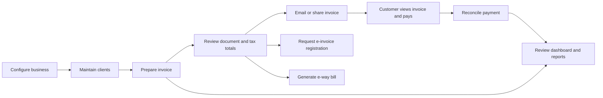
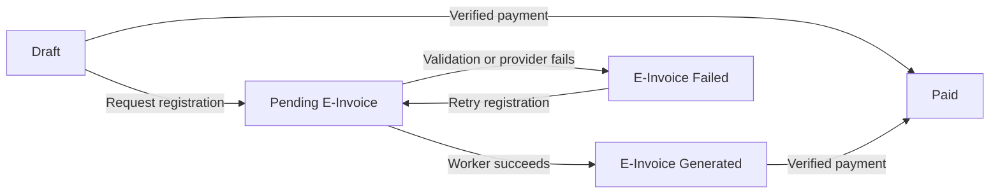

# QuantumBilling business guide

This document explains the business records, user journeys, calculations, integrations, and operating limits present in this repository. It describes application behavior; the tax rates, thresholds, due dates, and portal payloads implemented in code are not a verification of current statutory requirements.

For installation and demo login, start with [Getting started](getting-started.md). See [Database](database.md) for tables and relationships, [Technical architecture](technical-architecture.md) for implementation, and [Configuration](configuration.md) for environment variables and integration setup.

## 1. Purpose and scope

QuantumBilling is a web application for maintaining customers, preparing GST-oriented invoices, presenting invoice documents, requesting e-invoice registration, recording goods movement, receiving invoice payments, and reviewing billing information.

The main operational sequence is:

The repository contains billing and receivable functions. It does not contain a general ledger, a purchase accounting system, inventory balances, payroll, or bank statement reconciliation. A client can be categorized as a supplier, but that classification does not create a purchase ledger.

## 2. Business, account, and customer boundaries

| Term | Meaning in this application |
| --- | --- |
| Installation | One deployed application and PostgreSQL database. Accounts and installation-level records are shared here. |
| Business / organization | A firm with its own company details, GSTIN, invoice numbering, clients, documents, and settings. The business context creates a separate PostgreSQL schema such as `biz_1`. |
| User account | A person who signs in. Profile details, authentication tokens, and two-factor enrollment belong to the account. |
| Membership | The connection between a user and a business, with an `owner` or `staff` role. The same user can hold different roles in different businesses. |
| Client | A customer or other counterparty maintained in the business's client directory. A client record is separate from an application login. |
| Public invoice recipient | Someone opening a tokenized invoice link. They do not need an application account to view the document or start payment. |

The application supports creating businesses, choosing the current business, business memberships, and separate business tables. Authenticated workspace routes require a valid business choice, and database queries and business event topics follow that choice. Public invoice links and payment callback URLs resolve a business by slug; older unscoped links resolve business 1. Background jobs run in the business that queued them, and the daily scheduled tasks visit each active business in turn. [Technical architecture](technical-architecture.md#multi-business-model) describes how each entry point selects its business.

Within a business, staff collaborate on the same books. Client and invoice access is not restricted to the person who created the record.

### Choose or create a business

The business menu and `/businesses` list the active businesses the signed-in user belongs to. If the account belongs to exactly one business, it is selected automatically. With several memberships and no valid previous selection, workspace routes redirect to the picker.

Choosing a business posts to `/businesses/:id/switch`, verifies membership, saves the choice in the browser session, and reloads the workspace. Other workspace tabs using the same sign-in session are told to reload into the selected business. Different browser sessions can work in different businesses.

Someone who owns at least one active business can open `/businesses/new`, supply a name and optional GSTIN, and create another firm. Creation builds its schema/tables, organization settings, default invoice design, and creator's owner membership before switching the browser into it. A staff-only account cannot open the business creation page. An account with no active memberships sees the picker empty state and needs an owner to add it.

## 3. People, roles, and sign-in

The access model has two roles:

| Role | Business responsibility | Access implemented around the role |
| --- | --- | --- |
| Owner | Administer the business and its team. | Team administration and the full backup download are protected at the router. SMTP, integrations, and security sections check owner access. |
| Staff | Carry out billing and operational work. | Authenticated invoice, client, e-way bill, recurring, report, compliance, and Bin routes. There is no separate read-only or accountant role. |

Team administration at `/settings/team` works on the selected business. Owners can invite/add members, change roles, remove a membership, and revoke pending invitations. The application refuses to demote or remove the last owner. Removing someone from one business leaves their account and their memberships in other businesses intact.

Registration accepts the first account on an empty installation; subsequent registration requires an invitation. Invitations bind an email address to a business and a role, expire, and are claimed once. The context can add an existing account to an invited business, or let a new account accept pending invitations for its email.

Authentication features include password sign-in, email confirmation, emailed sign-in links, forgotten-password reset, password and email changes, optional remembered sessions, and TOTP two-factor authentication with recovery codes. An ordinary newly registered password account starts unconfirmed; the confirmation email completes activation. Demo account provisioning is described separately in [Getting started](getting-started.md), without publishing a shared password in this guide.

## 4. Configure the firm before invoicing

Settings are divided into independently saved sections. A change in one section is validated against that section's fields.

| Section | Business information maintained |
| --- | --- |
| General | Company/trade name, address, city, PIN, phone, contact email, GSTIN, PAN, state, currency, financial year, time zone, and date format. |
| Invoice | Number prefix, next number, number padding, default due days, and default terms. |
| E-Way Bill | Default transport mode, transporter identifier, value threshold, and an auto-generate preference. |
| Tax | Default line GST rate and flags for cess, composition scheme, and TDS. |
| Customization | Company logo and invoice design templates. |
| Notifications | Invoice-created, e-way-bill-generated, and filing-reminder preferences, plus the reminder lead window. |
| SMTP | Mail host, port, credentials, SSL setting, sender address/name, test delivery, and recent delivery results. |
| Integrations | UPI details, Razorpay keys, IRP-related settings, and an outbound webhook URL/secret. |
| Security | Allowed IP addresses/CIDRs, idle session timeout, mandatory two-factor preference, and audit retention. |
| Preferences | Language and list page-size preferences. These settings should not be read as a promise that every screen is translated or consumes every preference. |
| Backup & Restore | JSON business data export and restore. |

Some preferences are stored ahead of complete operational support. In particular, invoice totals currently keep cess at zero; saving cess/TDS flags does not introduce cess/TDS line calculations. The e-way-bill auto-generate preference does not replace the explicit generation workflow described below.

SMTP passwords, Razorpay secrets, IRP passwords, and webhook secrets saved through Settings use encrypted database fields. Secret inputs are write-only: saved values are not sent back to the browser, and submitting a blank secret preserves the stored value. Environment-supplied credentials and deployment encryption keys are described in [Configuration](configuration.md).

IP allowlists, idle timeout, and mandatory two-factor enforcement read installation-level security settings because they must apply before choosing a business. They protect the shared sign-in, rather than changing independently as a person switches firms. The Security form loads these shared rules and saves them transactionally with the business's security settings. An owner changing these rules affects everyone on the installation. Audit retention remains a business setting.

## 5. Client directory

Create a client at `/clients/new`, edit it from its detail page, and use `/clients` to search, filter, sort, and page through the directory.

A client stores:

- Registration type: Registered Business, Composition Scheme, SEZ Unit, Unregistered, Overseas, or Consumer.
- Name, display/legal name, GSTIN, PAN, business type, and Customer/Supplier/Both category.
- Email, phone, and phone country code.
- Billing and shipping addresses, including state and PIN; shipping can copy billing.
- Credit limit, payment terms in days, opening balance, notes, and Active/Inactive/Blocked status.

Registered, composition, and SEZ client types require a GSTIN. The application checks GSTIN/PAN formats, agreement between a PAN and the PAN embedded in a GSTIN, and the GSTIN state prefix against the chosen billing state. It does not contact a government service to verify registration status or calculate a GSTIN checksum.

The directory's outstanding figures derive from invoices still owed, adjusted by non-cancelled credit and debit notes, and floored at zero. Credit limits, opening balances, and client status are stored client attributes; they are not a full credit-control or account-ledger engine. A saved credit limit does not establish an enforced approval workflow for new invoices.

Changing a client later does not automatically rewrite the customer details copied onto an existing invoice.

## 6. Prepare and issue an invoice

### Document inputs

The invoice editor at `/invoices/new` accepts the client, document date, due date/payment terms, place of supply, invoice type, line items, remarks, terms, and design. Invoice types offered by the model are Tax Invoice, Bill of Supply, Export Invoice, Credit Note, and Debit Note. Offering a document type does not imply that every downstream integration accepts it.

Each item contains a description, optional HSN/SAC code, quantity, unit, rate, GST percentage, and display order. Supported units are Nos, Kg, Ltr, Mtr, Box, Set, Pcs, and Hrs. Quantities must be positive and can have up to three decimal places. A rate can contain two decimal places and must be non-negative. The line GST choices currently come from the compiled list `0`, `5`, `18`, and `40`.

At least one item, the invoice date, the place of supply, and the client name are required. A due date cannot precede the invoice date. Payment term presets include Due on Receipt and Net 7/15/30/45/60 Days, with a Custom option.

### Numbering and snapshots

Saving an invoice consumes the next configured number and advances the counter in the same database transaction. The settings row is locked during allocation, and an invoice-number unique constraint provides a second check. A Draft consumes a number too. Moving a document to the Bin or deleting it permanently does not give the number back.

The document stores copies of customer and issuing-company details alongside the client relationship. The company snapshot is populated at creation, so subsequent company setting changes do not automatically replace the issuer block on saved invoices.

The selected design's layout XML is also copied to the invoice. A Draft can refresh that layout snapshot when edited; a document beyond Draft keeps its saved layout. Template accent color and the organization logo are read live, so a historical document can still change its branding when those values change.

### Calculation rules

Money is held as integer paise, while the forms accept rupees. The calculation follows these steps:

1. Calculate each line as quantity × rate and round half-up to the nearest paisa.
2. Calculate each line's GST at its own percentage, again rounding half-up to a paisa.
3. Add line amounts to get taxable value and add line GST to get total GST.
4. Compare company state with place of supply. Matching states split tax into CGST and SGST; otherwise the full tax is IGST. If the tax total contains an odd paisa, SGST receives the remaining paisa after integer division for CGST.
5. Keep cess at zero in the current implementation.
6. Round the payable total to the nearest whole rupee, half-up, and store the difference in `round_off`.

For example, 2.5 units at ₹99.99 produce ₹249.98 before tax. At 18%, GST is ₹45.00. For a matching company state and place of supply, this becomes ₹22.50 CGST and ₹22.50 SGST. The pre-rounding amount is ₹294.98; `round_off` is ₹0.02 and the payable grand total is ₹295.00.

Totals are saved with the invoice rather than reconstructed whenever it is viewed. Changing calculation code later therefore does not silently recalculate every old document.

Currency, exchange rate, export type, and LUT fields exist in the model. The core arithmetic remains the same paise-based calculation and the document formatting is rupee-oriented. These fields do not establish a complete foreign-exchange ledger or all export tax treatments.

### Status and document actions

Stored invoice statuses are Draft, Pending E-Invoice, E-Invoice Generated, E-Invoice Failed, Paid, and Cancelled.

This diagram shows the main implemented actions, not an enforced accounting state machine. Statuses are fields used by forms, jobs, filters, and integrations; the application does not provide a separate finalization or posting ledger. Review an issued document's changes and cancellations as operational decisions rather than assuming every status transition is blocked automatically.

The invoice detail page supports previewing the document, editing it, viewing/downloading PDF, sending it by email, opening a public client link, requesting an e-invoice, creating an e-way bill, generating a payment link, and raising a credit/debit adjustment.

## 7. Customer delivery and payment

### PDF and email

Invoice preview and PDF output use the invoice document/layout system. PDF generation uses a headless Chromium browser; it requires the browser runtime described in [Getting started](getting-started.md). The customer-facing document can include company branding, customer details, lines, tax totals, terms, and available QR codes.

Invoice and payment-receipt emails are queued. A delivery ledger records queued, sent, and failed outcomes, and background jobs define retry behavior. SMTP can be configured through Settings or deployment configuration. In a standard local environment, the Swoosh development mailbox lets a developer inspect messages without actually sending them to customers. Account confirmation/reset mail is sent immediately through the current business when one is selected, otherwise business 1; its relay and delivery ledger follow that choice. Queued document mail is sent from the business that queued it, using that business's SMTP settings and delivery ledger.

### Public invoice page

A public token gives access to the invoice page at `/p/:slug/:token` and its PDF at `/p/:slug/:token/pdf`. The link resolves the business by slug independently of the recipient's sign-in state. Legacy `/pay/:token` and `/pay/:token/pdf` links resolve business 1. The recipient can read the invoice and start payment without creating an account. Treat a public link as access to that document: anyone who possesses the link can use it. The token has no implemented time-based expiry field. A binned invoice is excluded from public lookup, and unknown business slugs do not resolve another firm's invoice.

### Razorpay and direct UPI

Razorpay payment links request the full invoice amount with partial payments disabled. Credentials are read from the organization's saved settings first, then the environment. Development/test can allow simulated payment links; a simulated URL does not prove a payment can be collected. Production missing-key and request failures return an error instead of inventing a successful live link.

Direct UPI QR codes use the configured business UPI VPA, payee name, invoice reference, and amount. Without a configured VPA, a payment QR is not drawn. A scanned QR by itself does not mark the invoice paid; the application needs a verified provider webhook or an explicit reconciliation operation.

The Razorpay webhook checks a signature over the raw request body, applies source rate limits, deduplicates provider events, and checks invoice currency/amount before marking an invoice Paid. Payment-link events also check the link identifier where one was issued. The amount check accepts payment at least as large as the invoice total; it does not maintain a partial-payment balance or allocate an overpayment account. Configure a business callback at `/api/webhooks/razorpay/:slug`; the legacy `/api/webhooks/razorpay` path resolves business 1. This selects that business's webhook ledger and invoice numbering independently of browser sessions. Signature verification uses the deployment's `RAZORPAY_WEBHOOK_SECRET`.

Successful reconciliation saves the payment reference, updates open screens, records an audit event, produces a notification, queues a receipt when a client email exists, and emits the configured `invoice.paid` webhook. Repeated reconciliation of an already Paid invoice does not send another receipt. Payments for binned invoices are still looked up so received money is not discarded merely because the document left the active list.

## 8. E-invoice registration and exports

Requesting an e-invoice queues an Oban job and immediately shows Pending E-Invoice. The worker is designed to validate the invoice and then request an IRN. Success stores the IRN, acknowledgement number/date, signed QR payload, and signed invoice data; failure records E-Invoice Failed and is eligible for worker retry. The job carries the invoice's business, so it reads that business's IRP credentials and updates the invoice in its own books.

The IRP client defaults to sandbox mode (`IRP_SANDBOX=true`) and also simulates a response when required environment credentials are absent. Simulated IRNs and signed payload strings are local test artifacts. An E-Invoice Generated status produced in this mode is not evidence of registration with a government portal. The live client uses environment credentials; saving IRP-related settings alone does not fully configure that live path.

The XML download is a separate operation. It exports invoice data using e-invoice vocabulary after validation; it does not issue an IRN, sign a QR code, or change the invoice status. Its validation can reject an invoice accepted by the ordinary editor, including unsupported document types or missing required seller, buyer, or item details.

## 9. Goods movement and e-way bills

An e-way bill belongs to an invoice. A bill records its number, issue date, validity end, status, distance, transport mode, vehicle, transporter details, cancellation information, and Part-B vehicle history.

The normal workflow is:

1. Select an existing eligible invoice or generate a bill from its detail page.
2. Supply transport and consignment details.
3. Request the bill number, save the returned/local test details, and review the document.
4. If the vehicle changes, record a Part-B update with the new vehicle, place, mode, and reason.
5. Cancel a bill through the cancellation action when required, with a reason.

The application prevents a second kept, non-cancelled bill against the same invoice. Cancelled invoices are refused. It derives Expired from the validity timestamp instead of requiring a daily status update. Part-B updates are refused for expired or cancelled bills; cancellation uses a 24-hour window implemented in code.

The organization threshold controls the dashboard count of invoices above that value without a live bill. It does not hide lower-value invoices from the generation picker, and does not prove the selected consignment legally requires a bill.

The NIC client uses a local sandbox response when the URL is missing, and also on unexpected portal/network responses. It contains sample address, GSTIN, and transport fallback values. Review provider configuration and payload completeness before using this path for live transport operations. Local generation, cancellation, or Part-B success must not be treated as proof that the portal recorded the action.

Moving an e-way bill to the Bin only changes this application's records. It does not call the cancellation API. Use the cancellation action when the external bill needs cancellation.

## 10. Recurring billing

A recurring profile connects a client, title, item data, frequency, next run date, status, and an automatic-email flag. Supported frequencies are Monthly, Quarterly, and Annually; profiles can be Active or Paused.

The scheduled sweep is designed to find active due profiles and queue one job per profile. The billing operation creates a Draft invoice, uses the client's payment-term days for its due date, and advances the profile date in the same transaction. An enabled automatic-email flag queues delivery after creation when the client has an email address. The daily sweep runs once for each active business, and each profile job bills in the profile's own business; archived businesses are not billed.

Paused/binned profiles and profiles whose clients are binned are skipped. Binning a profile retains its schedule; restoring it can make it immediately due. Manual running and scheduled jobs share the same profile-processing function. Job uniqueness reduces repeated queue insertion, but overlapping manual processing is not a substitute for an accounting review of generated invoices.

Item data is stored as JSON text. If it is missing, empty, or invalid, the current implementation substitutes a default title-based service line with a ₹10,000 rate, HSN/SAC `998314`, quantity 1, and 18% tax. Review the item data before enabling a real profile; the profile changeset does not validate that JSON as invoice lines when the profile is saved.

Dates advance by calendar months, clamping to the last valid day of the target month. A run after several missed cycles advances the saved schedule one interval at a time; there is no separate configurable catch-up or proration policy.

## 11. Credit and debit adjustments

An invoice can have a separately stored Credit or Debit note with a reason, amount components, note number, client, source invoice, and Issued/Cancelled/Applied status. Default amounts are copied from the invoice; the user can enter an adjustment amount.

A non-cancelled Credit note reduces outstanding receivables, while a Debit note increases them. Paid or cancelled invoices are excluded from the open-receivable adjustment calculation. These notes do not execute a Razorpay refund, move money, or create a general-ledger posting. The separate note records are also distinct from choosing Credit Note or Debit Note as an invoice document type.

## 12. Dashboard, reports, and return data

The dashboard reads saved invoices to present invoice counts, billed values, tax summaries, open receivables, recent documents, a six-month tax trend, and status distribution. Headline values should be interpreted according to their queries: billed value is not the same as cash collected, and a Draft is already a saved numbered document. Monthly tax queries exclude Cancelled invoices; active-list totals also exclude the Bin. Open receivables use invoice statuses and note adjustments rather than a payment installment ledger.

Reports combine date range, report type, invoice status, client name, and GSTIN filters. The same filtered query drives summary totals, the monthly trend, status breakdown, tax rows, top clients, and CSV export. Large CSV exports stream rows rather than loading the entire report into a browser process.

Report names need to be read with their current implementation:

| Report choice | Current behavior |
| --- | --- |
| Sales Register / All Reports | Filtered saved invoices. |
| Tax Liability | Further restricts to E-Invoice Generated invoices. |
| ITC Summary | Further restricts invoice rows to those with zero cess. There is no purchase/input-credit ledger behind this view. |

General report sums combine taxable value and tax, rather than necessarily matching rounded grand totals. Client filtering uses the stored client name; separate clients with the same name can be combined in that view. Choose a status explicitly when the business question needs to exclude Drafts or Cancelled documents.

GSTR-1 export generates a JSON file for a selected `MMYYYY` period, grouping B2B, B2CL, B2CS, registered-counterparty notes, and HSN data. It excludes Cancelled and binned invoices, but includes Draft invoices because they already hold a number. It uses compiled classification thresholds and includes an HSN fallback for missing codes. Review the file with the responsible accountant before submission. Downloading it neither submits a return nor records a filing acknowledgement.

## 13. Compliance calendar and HSN/SAC reference

The compliance page generates a calendar from code-defined rules for GSTR-1, GSTR-3B, CMP-08, GSTR-9, and GSTR-9C. Financial years run April through March in this implementation.

The tracked set depends on organization registration settings: no GSTIN yields an empty tracked set; composition settings select the quarterly composition row instead of monthly regular returns; annual rows are also generated. The dashboard currently uses the broader calendar function, so it can display obligations different from the registration-filtered page/reminder set.

There is no persisted filing table or filing-status integration. `Compliance.filings/0` returns an empty list, so obligations become Pending or Overdue from dates alone and never Filed. A return already filed externally can still appear overdue here. Reminders are calendar prompts, not proof that a return is unfiled.

The HSN finder searches a compiled, curated set of goods/service codes by keyword or code prefix and displays its stored rates, category, effective date, and source label. It is not a live government master lookup, and a missing result does not establish that a code does not exist. Application format validation and reference data should be reviewed against the requirements applicable to the actual transaction.

## 14. Invoice designs and branding

Settings → Customization lists invoice designs and supports creating/duplicating, choosing a default, editing, archiving, and restoring templates. The design editor stores layout XML, including document blocks and page/text choices. Company-logo upload is handled separately from template layout storage.

A template is archived when deleted so existing invoice references remain meaningful. It can be restored from the Bin. A template referenced by invoices cannot be permanently purged; a restored design does not automatically become the default.

Test the preview and PDF after a design change. The layout is snapshotted onto invoices, while live logo/accent behavior can affect earlier documents as described in the invoicing section.

## 15. Notifications, audit trail, and integration events

The in-app bell stores events for invoice creation, payments, e-way bills, filing reminders, and delivery failures. It updates connected screens through PubSub. Notifications can be deduplicated by a producer-supplied key, and the bell presents the latest entries plus an unread count.

Read state is shared by the business rather than per user: marking a notice read clears it for colleagues using the same business feed. Business PubSub topics include the selected schema, so one firm's subscribed workspace does not receive another firm's invoice or notification feed. Pages opened before a business is selected receive an empty bell. Notices produced by background jobs, such as compliance reminders and final email-delivery failures, go to the feed of the business the job ran in.

Audit entries record selected business/security actions with resource identifiers, details, and optional actor/IP information. This is an operational activity trail, not a complete immutable financial event ledger. A maintenance job defines pruning of audit records according to the configured retention; email and webhook ledgers use 90 days. Read notifications can be pruned after 90 days; unread ones are retained. The pruning and compliance-reminder jobs run daily for each active business, using that business's own retention and reminder settings.

Outbound `invoice.created` and `invoice.paid` events are queued for delivery to a configured webhook endpoint. The webhook URL is checked against internal/private destinations, and a signing secret can authenticate deliveries. These payloads are integration summaries; some amount fields retain whole-rupee compatibility rather than exposing every stored paisa. Each delivery uses the webhook URL, signing secret and ledger of the business that produced the event. See [Configuration](configuration.md) and [Technical architecture](technical-architecture.md) before building a consumer.

## 16. Bin, restoration, and backup

The Bin at `/bin` brings together deleted invoices, clients, e-way bills, recurring profiles, and archived invoice designs. A normal delete leaves the underlying row available for restoration. Active lists, lookups, reports, and public invoice lookup exclude binned invoices.

Restoration can fail when a business identity was reused: another client may now hold the same GSTIN, or an invoice may have acquired another live e-way bill. Permanent deletion is only offered for records already in the Bin. Purging an invoice cascades its related invoice items, notes, and e-way bills; referenced templates and clients linked to credit notes have additional restrictions.

Backup export writes versioned JSON containing organization data, clients, templates, invoices/items, e-way bills/Part-B history, recurring profiles, notes, and audit entries. It retains Bin state and stored document values. Restore replaces those business records in a transaction and resynchronizes identifiers; it is a replacement operation, not a merge or import of a few customers.

Credential values are omitted from the backup file. Accounts, authentication sessions, and two-factor enrollment are not exported/restored. Notifications, mail/webhook ledgers, Oban jobs, and logo file bytes are also outside the business JSON. Preserve the deployment database and upload storage separately when a complete installation recovery is required. Reconfigure credentials and verify logo availability after moving data to a new environment.

The backup download route requires an owner. The current restore handler is on the authenticated Settings page and has not been given the same explicit owner check; do not describe restoration as consistently owner-only until that is addressed in application code. Restore's raw SQL qualifies the current business schema when resynchronizing identifiers.

## 17. Suggested operating sequence

1. Complete installation and environment configuration, provision an owner, and verify sign-in and email behavior.
2. Choose the correct business from the business menu, then configure its legal/business identity, state, GST details, invoice numbering, terms, and branding.
3. Add and verify clients, particularly registration type, place/state, addresses, and contact email.
4. Create an invoice, review each item and tax percentage, then verify totals, numbering, and PDF.
5. Share or email the customer document. Use live integrations only after confirming the environment is not producing sandbox artifacts.
6. Generate required transport documents and registration requests, then verify the real portal outcome independently when using live operations.
7. Review payment events, outstanding balances, and any rejected-payment notifications.
8. Review recurring profiles before their due dates, check generated Drafts, and investigate failed background jobs or mail.
9. Export reviewed report/return data for accounting work; maintain filing proof outside this application while filing records remain unimplemented.
10. Keep tested database/upload backups in addition to business JSON exports and use the Bin before permanent deletion.

## 18. Current implementation limits

The main boundaries to account for during acceptance testing are:

- Business schemas, membership-based roles, authenticated business selection/switching, team screens, business-scoped PubSub, public slug routes, payment callbacks, business-aware background jobs and sweeps, and installation security settings are implemented. Deleting a business (as opposed to archiving it) is not.
- IRP sandbox responses and NIC fallback responses can look successful locally without a government registration or transport update.
- Compliance dates and HSN rates are static application rules, filing records are absent, and exports are files rather than submission workflows.
- Cess/TDS, complete multi-currency/export accounting, purchase ITC, bank reconciliation, inventory, and a general ledger are not implemented as complete business systems.
- Recurring profiles substitute a fixed default line for absent/invalid items; profiles need explicit review before use with real customers.
- Receivables track whole invoice Paid/unpaid state plus notes, rather than partial payments, refunds, settlement fees, or allocation of overpayments.
- Role restrictions are not field-level permissions; backup restoration requires the access check called out above.
- Business JSON is a selective data backup and does not contain the whole deployed installation.

These limits come from the current source, including places where module comments describe earlier placeholder behavior that the implementation has since replaced. Treat executable context functions, schema fields, route guards, and worker code as the source of truth when extending the business workflow.

## 19. Source map

| Business area | Primary source |
| --- | --- |
| Businesses and membership | [businesses.ex](../lib/quantum_billing/businesses.ex), [accounts.ex](../lib/quantum_billing/accounts.ex), [scope.ex](../lib/quantum_billing/accounts/scope.ex), [business_picker_live.ex](../lib/quantum_billing_web/live/businesses/business_picker_live.ex), [business_controller.ex](../lib/quantum_billing_web/controllers/business_controller.ex) |
| Pages and access scopes | [router.ex](../lib/quantum_billing_web/router.ex), [user_auth.ex](../lib/quantum_billing_web/user_auth.ex) |
| Organization settings | [settings.ex](../lib/quantum_billing/settings.ex), [organization.ex](../lib/quantum_billing/settings/organization.ex), [installation_settings.ex](../lib/quantum_billing/installation_settings.ex) |
| Clients | [clients.ex](../lib/quantum_billing/clients.ex), [client.ex](../lib/quantum_billing/clients/client.ex) |
| Invoice creation and money | [invoices.ex](../lib/quantum_billing/invoices.ex), [invoice.ex](../lib/quantum_billing/invoices/invoice.ex), [invoice_item.ex](../lib/quantum_billing/invoices/invoice_item.ex), [money.ex](../lib/quantum_billing/money.ex) |
| Registration and e-way bills | [e_invoice.ex](../lib/quantum_billing/e_invoice.ex), [irp_client.ex](../lib/quantum_billing/e_invoice/irp_client.ex), [e_way_bills.ex](../lib/quantum_billing/e_way_bills.ex), [nic_client.ex](../lib/quantum_billing/e_way_bills/nic_client.ex) |
| Payment and delivery | [payments.ex](../lib/quantum_billing/payments.ex), [razorpay_client.ex](../lib/quantum_billing/payments/razorpay_client.ex), [mail.ex](../lib/quantum_billing/mail.ex), [payment_webhook_controller.ex](../lib/quantum_billing_web/controllers/payment_webhook_controller.ex) |
| Recurring and adjustments | [recurring.ex](../lib/quantum_billing/recurring.ex), [credit_notes.ex](../lib/quantum_billing/credit_notes.ex) |
| Reporting and compliance | [reports.ex](../lib/quantum_billing/reports.ex), [compliance.ex](../lib/quantum_billing/compliance.ex), [gstn_exporter.ex](../lib/quantum_billing/compliance/gstn_exporter.ex), [hsn_finder.ex](../lib/quantum_billing/hsn_finder.ex) |
| Designs and recovery | [templates.ex](../lib/quantum_billing/templates.ex), [bin_live.ex](../lib/quantum_billing_web/live/bin/bin_live.ex), [backup.ex](../lib/quantum_billing/backup.ex) |
| Notifications and retention | [notifications.ex](../lib/quantum_billing/notifications.ex), [events.ex](../lib/quantum_billing/events.ex), [audit_prune_worker.ex](../lib/quantum_billing/workers/audit_prune_worker.ex) |
