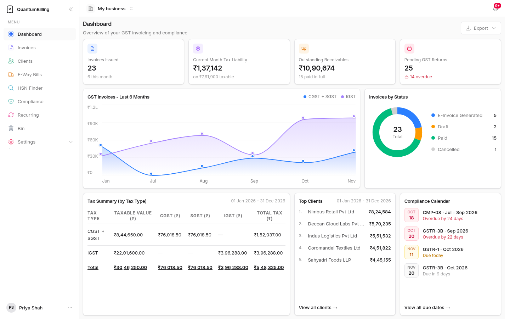

# QuantumBilling documentation

**Release v0.1.0** · REST API `v1` (OpenAPI 1.2.0) · Elixir 1.18.3 / OTP 27 · Phoenix 1.8 · PostgreSQL 16 · [MIT License](../LICENSE)

These guides describe the application and code in this repository: product workflows, developer setup, database structure, integrations, and deployment. They describe release v0.1.0. The release version is `version` in [`mix.exs`](../mix.exs); [deployment](deployment.md#versions-and-upgrades) explains what a version change means on a server.

## Reading order

| Step | Guide | Use it to… |
| --- | --- | --- |
| 1 | [Getting started](getting-started.md) | Run the app, migrate a database, seed demo data, and sign in |
| 2 | [Business](Business.md) | Understand business ownership, GST or VAT, currencies, custom fields, and billing workflows |
| 3 | [Configuration](configuration.md) | Configure secrets, SMTP, payments, and government portals |
| 4 | [Database](database.md) | Inspect schemas, relationships, storage types, and migrations |
| 5 | [Technical architecture](technical-architecture.md) | Trace requests, jobs, documents, notifications, business access, and security |
| 6 | [Tech stack](tech-stack.md) | Understand dependency versions and the purpose of each technology |
| 7 | [Development](development.md) | Change the code and run checks; [CONTRIBUTING](../CONTRIBUTING.md) covers pull requests and the rules every change must keep |
| 8 | [Deployment and operations](deployment.md) | Build and version releases, run them as a service behind a proxy, upgrade, monitor jobs, and back up an installation |
| 9 | [API](api.md) | Connect your own systems with API keys: endpoints, scopes, errors, idempotency ([OpenAPI document](openapi.json)) |
| 10 | [Webhooks](webhooks.md) | Receive signed events: catalogue, verification, retries, secret rotation |

## Several businesses on one installation

Each business keeps its books in a PostgreSQL schema of its own (`biz_1`, `biz_2`, …); accounts, memberships, the business registry, installation-wide sign-in rules and Oban jobs are shared in `public`. Every entry point selects its business before touching business tables: browser requests and LiveViews from the session and the user's memberships, public invoice links and Razorpay callbacks from the URL slug, background jobs from the `business_id` they were queued with, and daily sweeps by queuing one job per active business. Data that existed before the split is business 1. The [architecture guide](technical-architecture.md#multi-business-model) and [database guide](database.md) describe each entry point.

A business charges India GST or VAT and bills in one of seven currencies; under VAT the India-only features (IRP, e-way bills, GSTR-1, the HSN finder and the GST calendar) are hidden. Owners can add custom fields to six record types. The [Business guide](Business.md#tax-regime-india-gst-or-vat) covers both.

The guides distinguish locally simulated integrations from live external services. An IRN, payment link, or e-way-bill result produced in sandbox mode is demonstration data. The bundled HSN data and compiled compliance dates describe application behavior and require independent maintenance for operational use.

## Source of configuration

- [`.env.example`](../.env.example) is the tracked template; secret values are empty.
- `.env` is local and Git-ignored.
- [`config/runtime.exs`](../config/runtime.exs) reads runtime settings; nonblank file values fill unset or empty environment values.
- [`mix.exs`](../mix.exs) declares dependencies, aliases, and application metadata.
- [`priv/repo/migrations`](../priv/repo/migrations) contains public and historical migrations.
- [`priv/repo/tenant_migrations`](../priv/repo/tenant_migrations) evolves each business schema.

Actual login passwords, SMTP passwords, encryption keys, and provider secrets belong in environment configuration. Demo login refers to the values configured by the person running the app.
