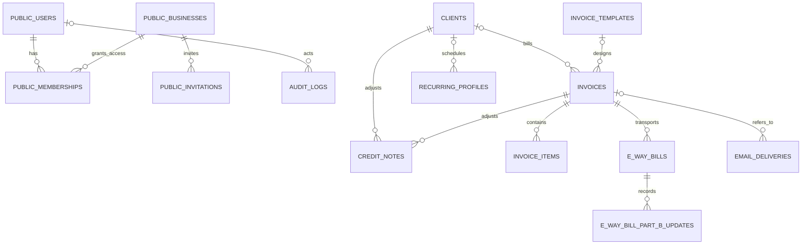

# Database structure and data lifecycle

QuantumBilling uses PostgreSQL through `QuantumBilling.Repo` and Ecto. This document describes the schema defined by the checked-in migrations and schema modules, including the business-schema migration added on 15 October 2026. It describes source code, not a verified inventory of a particular deployed database.

Related guides: [application architecture](technical-architecture.md), [business workflows](Business.md), [setup and migrations](getting-started.md), [configuration](configuration.md), and [deployment](deployment.md).

## 1. Database layout and ownership

One PostgreSQL database holds shared account data in `public` and separate business records in schemas named `biz_1`, `biz_2`, and so on. A schema is a namespace inside the same database; it is not a separate database or a separate PostgreSQL login.

| Location | Tables | Ownership |
| --- | --- | --- |
| `public` | `users`, `users_tokens` | An account and its sign-in state are shared across businesses. |
| `public` | `businesses`, `memberships`, `invitations` | Defines each business and who may access it. Roles belong to a membership. |
| `public` | `installation_settings` | Sign-in policy for the whole installation. |
| `public` | `oban_jobs`, `oban_peers` | Shared background-job storage and leader coordination. |
| `public` | `schema_migrations` | Ecto's record of shared/public migrations. |
| Each `biz_N` | `organization_settings`, `clients`, `invoices`, `invoice_items`, `credit_notes`, `e_way_bills`, `e_way_bill_part_b_updates`, `recurring_profiles`, `invoice_templates`, `notifications`, `email_deliveries`, `audit_logs`, `webhook_events` | The selected business's operational data. |
| Each `biz_N` | `schema_migrations` | Ecto's record of tenant migrations for that schema. |

Business tables do not carry a `business_id` column. Their schema establishes ownership. Consequently, invoice ID `42` in `biz_1` and invoice ID `42` in `biz_2` are different invoices. Invoice numbers, GSTIN uniqueness, public invoice tokens, and webhook event uniqueness are enforced within each business schema.

This separation is implemented by application query prefixes. PostgreSQL row-level security and separate database roles per business are not defined by these migrations. Access to the database with the application's database credentials can reach every business schema.

### Selecting a business in Elixir

The shared schema modules declare `@schema_prefix "public"`. Business schema modules leave their prefix unset. `Repo.put_business/1` stores the selected business in the current BEAM process, and `Repo.prepare_query/3` applies its schema to Ecto queries. Repository write wrappers apply the selected prefix to new business records. Loaded records already retain their schema prefix.

```elixir
alias QuantumBilling.{Businesses, Clients, Repo}

business = Businesses.get!(1)

Repo.with_business(business, fn ->
  Clients.list_clients()
end)
```

`Repo.with_business/2` restores the previous process selection after the callback. A new process does not automatically inherit this state. Requests, connected LiveViews, tasks, and workers must establish their own business selection. Without a selection, an unprefixed business-table query raises `QuantumBilling.Repo.NoBusinessError`. An explicitly supplied Ecto prefix takes precedence.

Raw `Repo.query!/2` SQL is not rewritten by `prepare_query/3`; raw SQL must qualify business tables and sequences with the correct, validated schema. A process-local selection is not an authorization check: membership must also be checked before selecting a business.

**Where the selection comes from:** the browser pipeline selects a business from the session and the user's active memberships; authenticated business routes and LiveView mounts require a selection. Event topics include the business schema. Public invoice/PDF routes and the Razorpay callback resolve their target business from the URL slug. Oban jobs carry `"business_id"` in their arguments and run inside that business; cron sweeps queue one job per active business. Migrations run with their own prefix: public migrations in `public`, tenant migrations in each `biz_N`. See the [architecture guide](technical-architecture.md#multi-business-model) for each entry point.

### Business identity on public links and callbacks

| Route | Business resolution |
| --- | --- |
| `/p/:slug/:token` and `/p/:slug/:token/pdf` | `Businesses.from_link(slug)` looks up the active business by slug, then the portal/PDF handler selects that business before looking up the invoice token. |
| Legacy `/pay/:token` and `/pay/:token/pdf` | With no slug, `Businesses.from_link(nil)` selects business ID 1, retaining access to links issued before the schema split. |
| `/api/webhooks/razorpay/:slug` | Resolves the active business by slug and selects it before claiming the event and reconciling an invoice. |
| Legacy `/api/webhooks/razorpay` | Selects business ID 1 for existing provider configurations. |

The slug selects the data namespace; it is not a credential. Public invoice access still requires the bearer token, and incoming Razorpay events still require a valid signature over the raw request body. Callback signature verification currently uses the installation environment's `RAZORPAY_WEBHOOK_SECRET`, rather than a separate per-business incoming-webhook secret column. `organization_settings.webhook_secret` is the business's **outgoing** webhook signing secret. Named public links exclude archived businesses; the legacy no-slug resolver calls the default-business lookup directly.

The endpoint clears any previous process business before dispatching each HTTP request and restores the prior state before sending its response. Public LiveViews retain their explicitly selected business for payment events and PubSub updates.

Sources: [Repo](../lib/quantum_billing/repo.ex), [Businesses](../lib/quantum_billing/businesses.ex), [business schema](../lib/quantum_billing/businesses/business.ex), [membership schema](../lib/quantum_billing/businesses/membership.ex), [business authentication hooks](../lib/quantum_billing_web/user_auth.ex), [router](../lib/quantum_billing_web/router.ex), [events](../lib/quantum_billing/events.ex), [public portal](../lib/quantum_billing_web/live/public_invoice_live.ex), [PDF controller](../lib/quantum_billing_web/controllers/invoice_pdf_controller.ex), [Razorpay callback](../lib/quantum_billing_web/controllers/payment_webhook_controller.ex), [endpoint process reset](../lib/quantum_billing_web/endpoint.ex).

## 2. Type and naming conventions

Unless a table says otherwise:

- `id` is a `bigint` primary key backed by a PostgreSQL sequence.
- `inserted_at` and `updated_at` are required `timestamp(0) without time zone` columns. Ecto's `:utc_datetime` type treats these as UTC. `audit_logs`, `users_tokens`, and migration tracking do not have `updated_at`.
- `string` means PostgreSQL `varchar(255)`; longer narrative fields are `text`.
- Foreign keys are `bigint`. Optional foreign keys may be `NULL`.
- A listed default is a database default. Ecto defaults and changeset validations may be stricter or different.
- Status/type values described below are application validations unless a database check constraint is explicitly listed.

### Money and quantities

Money is stored as integer **paise**, using `bigint`, rather than floating-point rupees. For example, ₹1,250.50 is stored as `125050`; ₹11,800 is stored as `1180000`.

| Money owner | Columns in paise |
| --- | --- |
| `clients` | `credit_limit`, `opening_balance`, `outstanding` |
| `invoice_items` | `rate`, `amount` |
| `invoices` | `taxable_value`, `cgst_amount`, `sgst_amount`, `igst_amount`, `cess_amount`, `round_off`, `grand_total` |
| `credit_notes` | `subtotal`, `tax_total`, `grand_total` |
| `organization_settings` | `ewb_threshold_value` |

`QuantumBilling.Money.Paise` reads amounts entered in rupees and casts them to paise. Its database load/dump operations use integers directly. Calculated totals use ordinary integer Ecto fields so they are not multiplied by 100 again. Import code must distinguish rupee input from already stored paise.

`invoice_items.quantity` and `invoices.total_quantity` use `numeric(15,3)`, supporting three decimal places. `tax_rate` remains an integer percentage. `exchange_rate` is PostgreSQL `numeric` and is not a money-in-paise column.

Line amounts and GST round half-up to a paisa. The invoice grand total then rounds half-up to the nearest whole rupee; `round_off` stores the signed difference. Intra-state tax splits into CGST and SGST without losing an odd paisa. Totals are stored on the invoice when saved, preserving the amounts billed at that time.

Sources: [money rules](../lib/quantum_billing/money.ex), [Paise Ecto type](../lib/quantum_billing/money/paise.ex), [money migration](../priv/repo/migrations/20261015112509_convert_money_to_paise.exs), [invoice calculations](../lib/quantum_billing/invoices/invoice.ex).

## 3. Shared tables in `public`

### `users`

A sign-in identity, separate from any business role.

| Columns | SQL type | Required/default | Meaning |
| --- | --- | --- | --- |
| `email` | `citext` | Required; unique | Case-insensitive email identity. |
| `username` | `citext` | Nullable; unique | Required by current registration changesets; nullable for older accounts. |
| `hashed_password` | `varchar(255)` | Nullable | PBKDF2 password hash; the plain password is virtual and is not a database column. |
| `confirmed_at` | timestamp | Nullable | Email confirmation time. |
| `full_name`, `phone`, `designation` | `varchar(255)` | Nullable | Account display information. |
| `banner_seed` | `bigint` | Nullable | Seed for the generated profile landscape; `NULL` uses the user ID. |
| `totp_secret` | `bytea` | Nullable | Encrypted TOTP enrolment secret. |
| `totp_confirmed_at` | timestamp | Nullable | A completed enrolment enables two-factor authentication. |
| `totp_last_used_at` | timestamp | Nullable | TOTP replay protection. |
| `recovery_codes` | `varchar(255)[]` | Required; `[]` | One-way hashed, single-use recovery codes. |

Unique B-tree indexes cover `email` and `username`. The historical `users.role` column is removed by the business-schema migration. The current database role is `memberships.role` for a particular business.

### `users_tokens`

| Columns | SQL type | Required/default | Meaning |
| --- | --- | --- | --- |
| `user_id` | `bigint` FK → `public.users.id` | Required | Deleting the user cascades to their tokens. |
| `token` | `bytea` | Required | Session token or hash of an emailed token, depending on context. |
| `context` | `varchar(255)` | Required | Token purpose, such as `session`, confirmation, login, or password reset. |
| `sent_to` | `varchar(255)` | Nullable | Email address the token was issued to. |
| `authenticated_at` | timestamp | Nullable | Original authentication time. |

There is an index on `user_id` and a unique index on `(context, token)`. This table has `inserted_at` only. Session tokens are stored as generated random bytes; email tokens are stored as SHA-256 hashes. Do not describe every row as a hashed token.

Expiry is enforced by application queries, not by a PostgreSQL TTL: session 14 days, magic link 15 minutes, confirmation/change-email 7 days, and password reset 4 hours. The installation idle timeout is a separate policy.

### `businesses`

| Columns | SQL type | Required/default | Meaning |
| --- | --- | --- | --- |
| `name` | `varchar(255)` | Required | Business display name. |
| `slug` | `varchar(255)` | Required; unique | Stable external identifier; generated from the name. |
| `schema` | `varchar(255)` | Required; unique | Business schema, such as `biz_1`. |
| `archived_at` | timestamp | Nullable | Archives the business without deleting its books. |

`businesses_schema_valid` permits only schema names matching `^biz_[0-9]+$`. Creation allocates a numeric business ID and uses `biz_<id>`. The application does not reuse an archived business's slug. Active-business lookups exclude archived rows, while migration sweeps include them.

### `memberships`

| Columns | SQL type | Required/default | Meaning |
| --- | --- | --- | --- |
| `user_id` | `bigint` FK → `public.users.id` | Required | Account that belongs to the business. |
| `business_id` | `bigint` FK → `public.businesses.id` | Required | Business being accessed. |
| `role` | `varchar(255)` | Required; `staff` | `owner` or `staff`. |

Unique `(user_id, business_id)` prevents duplicate memberships. An additional index covers `business_id`. Both foreign keys cascade on deletion. `memberships_role_valid` restricts roles to `owner` and `staff`. One account can own one business and be staff in another.

### `invitations`

| Columns | SQL type | Required/default | Meaning |
| --- | --- | --- | --- |
| `email` | `varchar(255)` | Required | Invitee address, normalized to lowercase by the application. |
| `token` | `bytea` | Required; unique | SHA-256 hash of a random invitation token. |
| `role` | `varchar(255)` | Required; `staff` | Membership role to grant. |
| `invited_by_id` | `bigint` FK → `public.users.id` | Nullable | Set to `NULL` when the inviter is deleted. |
| `business_id` | `bigint` FK → `public.businesses.id` | Required | Cascades when the business row is deleted. |
| `accepted_at` | timestamp | Nullable | `NULL` means not accepted. |
| `expires_at` | timestamp | Required | Application-generated expiry, currently seven days. |

Indexes cover `token` (unique), `email`, and `business_id`. The partial unique index `invitations_pending_email_unique` covers `(business_id, email)` where `accepted_at IS NULL`, allowing the same email to be invited to different businesses. The predicate does not exclude expired invitations; replacement/re-invitation logic must handle those rows. `invitations_role_valid` permits `owner` and `staff`.

### `installation_settings`

| Columns | SQL type | Required/default | Meaning |
| --- | --- | --- | --- |
| `allowed_ips` | `varchar(255)` | Nullable | Installation-wide IP allowlist. |
| `session_timeout_minutes` | `integer` | Required; `60` | Idle timeout policy. |
| `enforce_2fa` | `boolean` | Required; `false` | Installation-wide mandatory 2FA policy. |
| `singleton` | `boolean` | Required; `true` | Identifies the single policy row. |

A unique index on `singleton` plus `CHECK (singleton)` allows at most one row, and `installation_settings_timeout_positive` requires a positive timeout. An empty table is permitted; the context returns in-memory defaults until settings are saved. Sign-in policy is shared because it applies before a user chooses a business.

Sources: [account schema](../lib/quantum_billing/accounts/user.ex), [token schema and expiry rules](../lib/quantum_billing/accounts/user_token.ex), [invitation schema](../lib/quantum_billing/accounts/invitation.ex), [installation settings](../lib/quantum_billing/installation_settings.ex), [authentication migrations](../priv/repo/migrations/20260725171317_create_users_auth_tables.exs), [business-schema migration](../priv/repo/migrations/20261015115410_move_business_tables_into_their_own_schema.exs).

## 4. Operational tables in each `biz_N`

The definitions below come from the [tenant baseline migration](../priv/repo/tenant_migrations/20261015115500_tenant_baseline.exs) and current Ecto schemas. Every business has its own primary-key sequences and indexes for these tables.

### `organization_settings`

Application-managed business configuration. A unique index on `singleton` is used to maintain one normal settings row per business. Unlike `installation_settings`, this table has no check requiring `singleton = true`; the application creates the canonical row with `true`.

| Columns | SQL type | Required/default |
| --- | --- | --- |
| `company_name`, `trade_name`, `phone`, `email`, `gstin`, `pan`, `state`, `city`, `pincode` | `varchar(255)` | Nullable |
| `address` | `text` | Nullable |
| `currency` | `varchar(255)` | Required; `INR` in SQL |
| `financial_year` | `varchar(255)` | Nullable |
| `timezone` | `varchar(255)` | Required; `Asia/Kolkata` |
| `date_format` | `varchar(255)` | Required; `DD MMM YYYY` |
| `invoice_prefix` | `varchar(255)` | Required; `INV` |
| `invoice_next_number` | `integer` | Required; `1` |
| `invoice_number_padding` | `integer` | Required; `4` |
| `invoice_due_days` | `integer` | Required; `30` |
| `invoice_terms` | `text` | Nullable |
| `ewb_transport_mode` | `varchar(255)` | Required; `Road` |
| `ewb_transporter_id` | `varchar(255)` | Nullable |
| `ewb_threshold_value` | `bigint` paise | Required; `5000000` (₹50,000) |
| `ewb_auto_generate` | `boolean` | Required; `false` |
| `default_gst_rate` | `integer` | Required; `18` |
| `cess_enabled`, `composition_scheme`, `tds_enabled` | `boolean` | Required; `false` |
| `notify_invoice_created`, `notify_ewb_generated`, `notify_filing_reminders` | `boolean` | Required; `true` |
| `reminder_lead_days` | `integer` | Required; `7` |
| `language` | `varchar(255)` | Required; `en` |
| `rows_per_page` | `integer` | Required; `10` |
| `doc_logo_path` | `varchar(255)` | Nullable; uploaded asset reference |
| `smtp_host`, `smtp_username`, `smtp_from_email`, `smtp_from_name` | `varchar(255)` | Nullable |
| `smtp_port` | `integer` | Nullable; `587` |
| `smtp_ssl` | `boolean` | Nullable; `false` |
| `smtp_password` | `bytea` | Nullable; encrypted |
| `razorpay_key_id`, `irp_username`, `irp_client_id`, `webhook_url` | `varchar(255)` | Nullable |
| `razorpay_key_secret`, `irp_password`, `webhook_secret` | `bytea` | Nullable; encrypted |
| `upi_vpa`, `upi_payee_name` | `varchar(255)` | Nullable |
| `audit_retention_days` | `integer` | Nullable; `90` |
| `singleton` | `boolean` | Required; `true`; unique |

`organization_settings_numbering_valid` requires `invoice_next_number > 0` and padding between 0 and 11. `organization_settings_security_valid` requires `audit_retention_days` to be null or positive. The sign-in rules (`allowed_ips`, `session_timeout_minutes`, `enforce_2fa`) are not business columns: the schema-transfer migration copied business 1's values to `public.installation_settings`, and the tenant migration `20261015121215_drop_installation_rules_from_business_settings` removed them from every business schema. `Organization` keeps them as virtual fields; `Settings.with_installation_rules/1` fills them in for the Security form, and saving that section writes them to `InstallationSettings` in the same transaction as the business's audit retention. The browser security plug reads that shared table. Audit retention remains specific to each business.

Database and Ecto defaults are not interchangeable: for example, the organization Ecto schema currently uses a human-readable currency label while the SQL default is `INR`. Normal writes pass through the application's settings changesets.

Source: [organization schema and validation sections](../lib/quantum_billing/settings/organization.ex), [settings context](../lib/quantum_billing/settings.ex).

### `clients`

Business customers/parties with GST identity, contact details, billing/shipping addresses, and credit terms.

| Columns | SQL type | Required/default |
| --- | --- | --- |
| `client_type`, `name` | `varchar(255)` | Required |
| `display_name`, `gstin`, `pan`, `legal_name`, `business_type`, `category` | `varchar(255)` | Nullable |
| `phone_country_code` | `varchar(255)` | Required; `+91` |
| `phone`, `email` | `varchar(255)` | Nullable |
| `billing_line1`, `billing_line2`, `billing_city`, `billing_state`, `billing_pin` | `varchar(255)` | Nullable |
| `shipping_same_as_billing` | `boolean` | Required; `true` |
| `shipping_line1`, `shipping_line2`, `shipping_city`, `shipping_state`, `shipping_pin` | `varchar(255)` | Nullable |
| `credit_limit`, `opening_balance`, `outstanding` | `bigint` paise | Required; `0` |
| `payment_terms_days` | `integer` | Required; `30` |
| `notes` | `text` | Nullable |
| `status` | `varchar(255)` | Required; `Active` |
| `deleted_at` | timestamp | Nullable; Bin marker |

Application client types are Registered Business, Composition Scheme, SEZ Unit, Unregistered, Overseas, and Consumer; statuses are Active, Inactive, and Blocked. Changesets validate GSTIN/PAN/state consistency where applicable. These are application rules, not SQL enum/check constraints.

The partial unique `clients_gstin_unique` index covers non-null GSTINs only when `deleted_at IS NULL`. B-tree indexes cover `name`, `email`, and `status`; GIN trigram indexes cover substring searches on `name`, `gstin`, and `email`. A partial `deleted_at` index supports the Bin.

**Balance source:** `clients.outstanding` is a historical storage column, not a maintained receivables ledger. The clients context computes displayed outstanding from kept invoices not Paid/Cancelled, minus non-cancelled credit notes and plus debit notes, floored at zero. It writes the computed value into the returned struct for display. Direct SQL reporting should reproduce that rule rather than summing the stored client column.

Source: [client schema](../lib/quantum_billing/clients/client.ex), [computed client balances](../lib/quantum_billing/clients.ex), [invoice balance query](../lib/quantum_billing/invoices.ex).

### `invoices`

A saved invoice contains both relationships and snapshots. Editing a customer's address or the issuing business later does not automatically rewrite the invoice's stored party details.

| Columns | SQL type | Required/default |
| --- | --- | --- |
| `invoice_number` | `varchar(255)` | Required; unique |
| `invoice_type` | `varchar(255)` | Required; `Tax Invoice` |
| `invoice_date` | `date` | Required |
| `due_date` | `date` | Nullable |
| `payment_terms` | `varchar(255)` | Nullable |
| `place_of_supply` | `varchar(255)` | Required |
| `client_id` | `bigint` FK → same-schema `clients.id` | Nullable; delete sets `NULL` |
| `client_name` | `varchar(255)` | Required; snapshotted |
| `client_gstin`, `client_pan`, `client_email`, `client_state`, `client_city`, `client_pincode` | `varchar(255)` | Nullable; snapshotted |
| `client_billing_address` | `text` | Nullable; snapshotted |
| `company_name`, `company_gstin`, `company_state` | `varchar(255)` | Nullable; snapshotted |
| `company_address` | `text` | Nullable; snapshotted |
| `remarks`, `terms` | `text` | Nullable |
| `total_items` | `integer` | Required; `0` |
| `total_quantity` | `numeric(15,3)` | Required; `0` |
| `taxable_value`, `cgst_amount`, `sgst_amount`, `igst_amount`, `cess_amount`, `round_off`, `grand_total` | `bigint` paise | Required; `0` |
| `status` | `varchar(255)` | Required; `Draft` |
| `template_id` | `bigint` FK → same-schema `invoice_templates.id` | Nullable; delete sets `NULL` |
| `layout_xml` | `text` | Nullable; frozen layout structure at issue |
| `irn`, `ack_number` | `varchar(255)` | Nullable; government registration details |
| `ack_date` | timestamp | Nullable |
| `signed_qr_code`, `signed_invoice` | `text` | Nullable; government response artifacts |
| `currency` | `varchar(255)` | Nullable; `INR` |
| `exchange_rate` | `numeric` | Nullable; `1.0` |
| `export_type` | `varchar(255)` | Nullable; `DOMESTIC` |
| `lut_number` | `varchar(255)` | Nullable |
| `razorpay_payment_link_id`, `razorpay_payment_url`, `razorpay_payment_id` | `varchar(255)` | Nullable; payment references |
| `public_token` | `varchar(255)` | Nullable in SQL; unique |
| `deleted_at` | timestamp | Nullable; Bin marker |

Application statuses are Draft, Pending E-Invoice, E-Invoice Generated, E-Invoice Failed, Paid, and Cancelled. Application invoice types are Tax Invoice, Bill of Supply, Export Invoice, Credit Note, and Debit Note. The separate `credit_notes` table holds adjustment-note records; it is not merely an alias for the invoice type field.

`invoices_totals_non_negative` checks the taxable value, tax components, grand total, total item count, and total quantity. `round_off` is deliberately excluded because it can be negative. The application requires a line item and rejects a due date before the invoice date; those rules are not database checks.

Invoice number allocation locks the business's organization row using `FOR UPDATE`, inserts the invoice, and advances `invoice_next_number` in the same Ecto transaction. A Draft also consumes a number. Binning or cancelling never returns a number to the series. The unique invoice-number index is the final duplicate backstop.

The changeset generates `public_token` from 24 cryptographically random bytes with an `inv_` prefix. It is stored as a usable bearer token, not hashed or encrypted; anyone with a public invoice URL can access that invoice's public page. SQL nullability preserves compatibility, while normal changeset writes fill a missing token.

Indexes:

- Unique B-tree indexes: `invoice_number`, `public_token`, and non-null `irn` (`invoices_irn_unique`).
- B-tree lookups: `client_id`, `template_id`, `invoice_date`, `inserted_at`, `status`, `(status, invoice_date)`, `client_name`, `client_gstin`, `irn`, `razorpay_payment_link_id`, `razorpay_payment_id`.
- GIN trigram search: `invoice_number`, `client_name`, `client_gstin`.
- Partial list-sort indexes where `deleted_at IS NULL`: `(grand_total, id)`, `(due_date, id)`, `(status, id)`.
- Partial Bin index: `deleted_at` where it is not null.

Source: [invoice schema](../lib/quantum_billing/invoices/invoice.ex), [numbering and invoice context](../lib/quantum_billing/invoices.ex), [sort-index migration](../priv/repo/migrations/20261015110034_add_invoice_sort_indexes.exs).

### `invoice_items`

| Columns | SQL type | Required/default |
| --- | --- | --- |
| `invoice_id` | `bigint` FK → same-schema `invoices.id` | Required; delete cascades |
| `description` | `varchar(255)` | Required |
| `hsn_sac` | `varchar(255)` | Nullable |
| `quantity` | `numeric(15,3)` | Required; `1` |
| `unit` | `varchar(255)` | Required; `Nos` |
| `rate`, `amount` | `bigint` paise | Required; `0` |
| `tax_rate` | `integer` percentage | Required; `18` |
| `position` | `integer` | Required; `0`; line ordering |

`invoice_id` is indexed. Database checks require `quantity > 0`, `rate >= 0`, and `amount >= 0`. The application calculates `amount` from quantity × rate rather than trusting a submitted amount. Unit choices and GST slabs are validated in Elixir.

Source: [invoice item schema](../lib/quantum_billing/invoices/invoice_item.ex).

### `credit_notes`

| Columns | SQL type | Required/default |
| --- | --- | --- |
| `note_number` | `varchar(255)` | Required; unique |
| `note_type` | `varchar(255)` | Required; `Credit` |
| `invoice_id` | `bigint` FK → same-schema `invoices.id` | Required; delete cascades |
| `client_id` | `bigint` FK → same-schema `clients.id` | Required; delete restricts |
| `reason` | `varchar(255)` | Nullable |
| `subtotal`, `tax_total`, `grand_total` | `bigint` paise | Nullable in SQL; `0` |
| `status` | `varchar(255)` | Nullable in SQL; `Issued` |

Indexes cover unique `note_number`, `invoice_id`, and `client_id`. Application types are Credit/Debit and statuses are Issued/Cancelled/Applied. The changeset requires a non-negative grand total; no corresponding money or status check exists in the baseline SQL. The context generates a `CN-` or `DN-` number tied to the invoice number plus a runtime unique suffix, rather than consuming the invoice sequence.

Source: [credit-note schema](../lib/quantum_billing/credit_notes/credit_note.ex), [credit-note context](../lib/quantum_billing/credit_notes.ex).

### `e_way_bills`

| Columns | SQL type | Required/default |
| --- | --- | --- |
| `invoice_id` | `bigint` FK → same-schema `invoices.id` | Required; delete cascades |
| `ewb_number` | `varchar(255)` | Required; unique |
| `ewb_date` | `date` | Required |
| `valid_until` | `timestamp(0) without time zone` | Required; Ecto `:naive_datetime` |
| `status` | `varchar(255)` | Required; `Active` |
| `distance_km` | `integer` | Required |
| `mode_of_transport` | `varchar(255)` | Required; `Road` |
| `vehicle_number`, `transporter_id`, `transporter_name` | `varchar(255)` | Nullable |
| `cancelled_at` | timestamp | Nullable |
| `cancellation_reason` | `varchar(255)` | Nullable |
| `deleted_at` | timestamp | Nullable; Bin marker |

Application statuses stored in this table are Active and Cancelled. Expiry is calculated from validity; it is not an additional persisted status enum. `valid_until` is a naive datetime with no stored offset. The current expiry code compares it to `NaiveDateTime.utc_now()`, and sandbox validity is generated from that same clock; it is not an Ecto `:utc_datetime` column.

Indexes cover unique `ewb_number`, `invoice_id`, `status`, `(ewb_date, id)`, substring search on `ewb_number` using GIN trigrams, and binned `deleted_at` rows. `e_way_bills_one_live_bill_per_invoice_index` uniquely covers `invoice_id` where `status <> 'Cancelled' AND deleted_at IS NULL`. This retains old cancelled bills while allowing a replacement. Restoring a binned bill can fail if another live bill has taken its invoice's slot.

### `e_way_bill_part_b_updates`

| Columns | SQL type | Required/default |
| --- | --- | --- |
| `e_way_bill_id` | `bigint` FK → same-schema `e_way_bills.id` | Required; delete cascades |
| `vehicle_number` | `varchar(255)` | Required |
| `mode_of_transport` | `varchar(255)` | Required; `Road` |
| `place`, `reason` | `varchar(255)` | Nullable |
| `updated_on` | timestamp | Required; transport update time |

`e_way_bill_id` is indexed. A separate child row retains each Part-B vehicle update, instead of replacing a single vehicle column on the invoice.

Sources: [e-way bill schema](../lib/quantum_billing/e_way_bills/e_way_bill.ex), [Part-B schema](../lib/quantum_billing/e_way_bills/part_b_update.ex), [e-way bill table migration and historical backfill](../priv/repo/migrations/20260925103207_create_e_way_bills.exs).

### `recurring_profiles`

| Columns | SQL type | Required/default |
| --- | --- | --- |
| `title` | `varchar(255)` | Required |
| `frequency` | `varchar(255)` | Required; `Monthly` |
| `next_run_date` | `date` | Required |
| `status` | `varchar(255)` | Required; `Active` |
| `auto_send_email` | `boolean` | Required; `true` |
| `client_id` | `bigint` FK → same-schema `clients.id` | Nullable in SQL; delete sets `NULL` |
| `items_json` | `text` | Nullable; JSON encoded as text |
| `deleted_at` | timestamp | Nullable; Bin marker |

The changeset requires `client_id` even though the database permits null after a client is physically deleted. Frequencies are Monthly/Quarterly/Annually and statuses Active/Paused in the application. The recurring sweep reads active, kept profiles by next-run date. Indexes cover `client_id`, `next_run_date`, `status`, `(status, next_run_date)`, and binned `deleted_at` rows. There is no separate recurring-item table or persisted foreign key from a generated invoice back to a profile.

Source: [recurring-profile schema](../lib/quantum_billing/recurring/recurring_profile.ex).

### `invoice_templates`

| Columns | SQL type | Required/default |
| --- | --- | --- |
| `name` | `varchar(255)` | Required |
| `layout_xml` | `text` | Required; layout source |
| `accent` | `varchar(255)` | Required; `#18181b` |
| `is_default` | `boolean` | Required; `false` |
| `archived_at` | timestamp | Nullable |

A partial unique index permits one active template per name (`archived_at IS NULL`). `invoice_templates_one_default_index` permits at most one `is_default = true` template per business. The application swaps defaults transactionally. Templates are archived in ordinary use. Invoice layout structure is snapshotted to `invoices.layout_xml`, while the template's live branding/accent can still affect rendering.

Source: [template schema](../lib/quantum_billing/templates/invoice_template.ex), [template context](../lib/quantum_billing/templates.ex).

### `notifications`

| Columns | SQL type | Required/default |
| --- | --- | --- |
| `kind`, `title` | `varchar(255)` | Required |
| `body`, `path`, `dedupe_key` | `varchar(255)` | Nullable |
| `severity` | `varchar(255)` | Required; `info` |
| `read_at` | timestamp | Nullable; unread if null |

Notifications and their read state belong to the business, not an individual user. There is no user-notification join table. Application kinds are invoice/payment/e_way_bill/compliance/mail/client/system; severities are info/success/warning/error.

Indexes cover `(inserted_at, id)` for feed ordering, unread `read_at` rows, and unique non-null `dedupe_key` to prevent repeated notices. The feed records completed events; it is not the background-job queue.

Source: [notification schema](../lib/quantum_billing/notifications/notification.ex), [notification migration](../priv/repo/migrations/20260927124619_create_notifications.exs).

### `email_deliveries`

| Columns | SQL type | Required/default |
| --- | --- | --- |
| `to_email` | `varchar(255)` | Required |
| `kind` | `varchar(255)` | Required; `invoice` |
| `subject` | `varchar(255)` | Nullable |
| `invoice_id` | `bigint` FK → same-schema `invoices.id` | Nullable; delete sets `NULL` |
| `status` | `varchar(255)` | Required; `queued` |
| `attempts` | `integer` | Required; `0` |
| `last_error` | `text` | Nullable |
| `delivered_at` | timestamp | Nullable |

`email_deliveries_status_known` permits queued/sent/failed. Application kinds are invoice/payment_receipt/test/account/e_way_bill. Indexes cover `status`, `invoice_id`, and `inserted_at`. This is delivery history separate from Oban retry/job records. A sent status records delivery handling by the mail subsystem; it does not establish that a recipient opened an email.

Source: [delivery schema](../lib/quantum_billing/mail/delivery.ex), [mail context](../lib/quantum_billing/mail.ex).

### `audit_logs`

| Columns | SQL type | Required/default |
| --- | --- | --- |
| `user_id` | `bigint` FK → **`public.users.id`** | Nullable; delete sets `NULL` |
| `action`, `resource_type` | `varchar(255)` | Required |
| `resource_id` | `varchar(255)` | Nullable; generic resource identifier |
| `details` | `jsonb` | Nullable; `{}` |
| `ip_address` | `varchar(255)` | Nullable |
| `inserted_at` | timestamp | Required; no `updated_at` |

Indexes cover `user_id`, `action`, `(resource_type, resource_id)`, and `inserted_at`. This is the business-table foreign key that crosses into the shared account schema. `resource_id` is not a foreign key to every resource type. Audit details are not encrypted by the encrypted Ecto types. Audit pruning uses the business's configured retention; this is an application audit trail, not a database-wide immutable change log.

Source: [audit schema](../lib/quantum_billing/audit/audit_log.ex), [audit context](../lib/quantum_billing/audit.ex).

### `webhook_events`

| Columns | SQL type | Required/default |
| --- | --- | --- |
| `provider`, `event_id` | `varchar(255)` | Required |
| `event_type` | `varchar(255)` | Nullable |
| `status` | `varchar(255)` | Required; `processed` |
| `error` | `text` | Nullable |
| `payload` | `bytea` | Required; encrypted JSON map |

The unique `(provider, event_id)` index provides an idempotency boundary within the business. `inserted_at` is indexed. Application statuses are processed/ignored/failed, with no status SQL check in the baseline. There is no invoice FK here; provider payload/reference reconciliation resolves the invoice.

Source: [webhook-event schema](../lib/quantum_billing/webhooks/webhook_event.ex), [payment processing](../lib/quantum_billing/payments.ex), [encrypted payload migration](../priv/repo/migrations/20261010062124_encrypt_webhook_event_payloads.exs).

### `compliance_tasks`

Tasks and reminders added by hand on the Compliance page. GST obligations are calculated from the rules and are not stored here.

| Columns | SQL type | Required/default |
| --- | --- | --- |
| `title` | `varchar(255)` | Required |
| `notes` | `text` | Nullable |
| `category` | `varchar(255)` | Required; `other` |
| `due_date` | `date` | Required |
| `kind` | `varchar(255)` | Required; `task` (or `reminder`) |
| `status` | `varchar(255)` | Required; `open` (or `done`) |
| `completed_at`, `reminded_at` | `timestamp(0)` | Nullable |
| `remind_days_before` | `integer` | Required; `1` |
| `created_by_id` | `bigint` FK to `public.users` | Nullable; set to null when the user is deleted |

`due_date` and `status` are indexed. `reminded_at` is what makes a reminder post once.

Source: [task schema](../lib/quantum_billing/compliance/task.ex), [compliance context](../lib/quantum_billing/compliance.ex).

### `calendar_connections`

One row per provider (`google`, `caldav`, `feed`), enforced by a unique index on `provider`.

| Columns | SQL type | Required/default |
| --- | --- | --- |
| `provider` | `varchar(255)` | Required |
| `secret` | `bytea` | Nullable; encrypted Google refresh token or CalDAV password |
| `url` | `text` | Nullable; CalDAV collection URL |
| `username` | `varchar(255)` | Nullable; CalDAV login |
| `calendar_id` | `varchar(255)` | Required; `primary` |
| `feed_token_hash` | `bytea` | Nullable; hash of the private feed token, whose raw value is shown once |
| `last_synced_at` | `timestamp(0)` | Nullable |
| `last_error` | `varchar(255)` | Nullable; a fixed sentence, never provider response text |
| `connected_by_id` | `bigint` FK to `public.users` | Nullable; set to null when the user is deleted |

Source: [connection schema](../lib/quantum_billing/calendars/connection.ex), [calendars context](../lib/quantum_billing/calendars.ex).

### `calendar_event_links`

Maps each task or deadline to the event created for it, so a change updates that event instead of adding a second one.

| Columns | SQL type | Required/default |
| --- | --- | --- |
| `connection_id` | `bigint` FK to `calendar_connections` | Required; deleted with the connection |
| `item_key` | `varchar(255)` | Required; unique per connection |
| `external_id` | `text` | Required |
| `etag` | `text` | Nullable |
| `fingerprint` | `varchar(255)` | Required; unchanged items are not sent again |
| `due_date` | `date` | Required |

Source: [event link schema](../lib/quantum_billing/calendars/event_link.ex).

## 5. Relationship and deletion map



Unprefixed operational entities in the diagram are in one selected `biz_N`. Edges represent foreign keys, not permission checks.

| Physical deletion | Database result |
| --- | --- |
| Delete `public.users` | Cascades user tokens/memberships; nulls invitation inviter and business audit user references. |
| Delete `public.businesses` | Cascades memberships/invitations. It does **not** automatically drop the PostgreSQL schema or its books. |
| Delete a client | Nulls invoice and recurring-profile client references; is restricted when credit notes still reference it. |
| Delete an invoice | Cascades line items, credit notes, and e-way bills; nulls email-delivery invoice references. |
| Delete an e-way bill | Cascades its Part-B updates. |
| Delete an invoice template | Nulls invoice template references. |

Normal Bin operations do not execute these physical cascades. `clients`, `invoices`, `e_way_bills`, and `recurring_profiles` use `deleted_at`, with explicit `kept/1`/`binned/1` query helpers. Raw SQL must add the intended filter itself. Invoice and e-way bill numbers remain consumed when binned. A restore can encounter a uniqueness conflict where a later live record now occupies the client's GSTIN or invoice's live-bill slot.

## 6. Background-job and migration tables

### `public.oban_jobs`

The project calls `Oban.Migration.up(version: 14)`. Oban owns this schema and its migrations.

| Columns | SQL type | Purpose |
| --- | --- | --- |
| `id` | `bigserial` PK | Job ID. |
| `state` | `public.oban_job_state` enum | available/suspended/scheduled/executing/retryable/completed/discarded/cancelled. |
| `queue`, `worker` | `text` | Queue and Elixir worker module. |
| `args` | `jsonb` | Job payload; required, defaults to `{}`. |
| `meta` | `jsonb` | Job metadata; defaults to `{}`. |
| `errors` | `jsonb[]` | Recorded failures; required, defaults to `[]`. |
| `attempt`, `max_attempts`, `priority` | `integer` | Attempt/retry/priority controls. Defaults 0/20/0. |
| `attempted_by`, `tags` | `text[]` | Executor information and tags; tags default to `[]`. |
| `inserted_at`, `scheduled_at` | `timestamp(6) without time zone` | Required; UTC database-time defaults. |
| `attempted_at`, `completed_at`, `discarded_at`, `cancelled_at` | `timestamp(6) without time zone` | Nullable lifecycle times. |

Checks constrain worker/queue names to 1–127 characters, require positive `max_attempts`, keep attempts from 0 through `max_attempts`, and require non-negative priority. Indexes support `(state, queue, priority, scheduled_at, id)`, `(state, cancelled_at)`, `(state, discarded_at)`, and GIN searches over `args` and `meta`. There is no business FK in this table; workers must carry/resolve business identity in their arguments or sweep businesses explicitly. Job arguments and error records are not automatically encrypted by the business credential types.

### `public.oban_peers`

Oban's leader coordination uses `name` (`text` primary key), `node` (`text`), `started_at`, and `expires_at` (`timestamp(6) without time zone`), all required. These rows are operational coordination state, not business records.

### `schema_migrations`

Ecto tracks migration versions separately in `public.schema_migrations` and each `biz_N.schema_migrations`. The tenant table has `version bigint PRIMARY KEY` and nullable `inserted_at timestamp(0) without time zone`. Do not insert/delete versions manually to conceal a failed migration; repair the underlying migration/database state through a reviewed migration.

Source: [Oban migration entrypoint](../priv/repo/migrations/20260912112206_add_oban_jobs_table.exs), [Oban configuration](../config/config.exs), and the installed Oban PostgreSQL migration modules in `deps/oban/lib/oban/migrations/postgres/`.

## 7. Encryption, hashes, and secrets

| Data | Storage | Runtime key |
| --- | --- | --- |
| User passwords | PBKDF2 hash | No reversible encryption key. |
| Recovery codes | One-way hashes | No reversible encryption key. |
| Email and invitation tokens | SHA-256 hash | Raw token is delivered to the recipient. |
| Session tokens | Random bytes in `users_tokens.token` | Signed session/cookie handling protects transport. |
| TOTP secret | AES-256-GCM encrypted `bytea` | `TOTP_ENCRYPTION_KEY`. |
| SMTP password, Razorpay key secret, IRP password, outgoing webhook secret, Google Calendar refresh token, CalDAV password | AES-256-GCM encrypted `bytea` | `SECRETS_ENCRYPTION_KEY`. |
| Calendar feed token | SHA-256 hash | Raw token is shown once to the owner. |
| Incoming webhook payload | JSON encoded, then AES-256-GCM encrypted `bytea` | `SECRETS_ENCRYPTION_KEY`. |
| Public invoice token | Plain random bearer token in `varchar(255)` | No encrypted Ecto type. |

The shared cipher stores a 16-byte random IV, a 16-byte authentication tag, and ciphertext. It derives a 256-bit AES key by SHA-256 hashing the configured key value. Different authenticated-data strings separate TOTP, credentials, and webhook payload purposes. Tampering, a wrong key, or copying ciphertext between those purposes fails decryption.

Encryption protects the listed columns at rest. It does not encrypt customer identities, invoice details, audit maps, job arguments, usernames, or all integration identifiers. A running application with the keys can decrypt the protected fields.

Keep encryption keys stable and backed up separately from database data. Changing them makes existing ciphertext unreadable; there is no transparent key-version rotation mechanism in these types. Losing the TOTP key requires re-enrolment; losing the secrets key requires re-entering credentials and prevents reading old webhook payloads. Configure keys through the environment; do not put actual values in Markdown, SQL examples, or source control.

Sources: [cipher envelope](../lib/quantum_billing/encrypted/cipher.ex), [TOTP type](../lib/quantum_billing/encrypted/binary.ex), [credential type](../lib/quantum_billing/encrypted/secret.ex), [webhook map type](../lib/quantum_billing/encrypted/map.ex), [runtime configuration](../config/runtime.exs).

## 8. Migrations and business provisioning

### Public and tenant migration directories

| Directory | Runs against | Use for |
| --- | --- | --- |
| `priv/repo/migrations` | `public`, with historical migrations that created the original business tables before their move | Shared account, membership, installation, and infrastructure changes. |
| `priv/repo/tenant_migrations` | Every business schema using an Ecto prefix | Future changes to business-owned tables. |

The tenant directory starts with `20261015115500_tenant_baseline` (creates the 13 original business tables with their indexes, foreign keys and checks; already recorded as applied in `biz_1`, which received its tables by the schema transfer). Later migrations each make one change, such as `20261030120747_create_compliance_tasks` and `20261030120748_create_calendar_integrations`. A new business runs all of them, so it ends with the same structure as `biz_1`; a test compares the two schemas' columns, indexes and constraints.

`mix ecto.migrate` is a project alias: it runs standard public migrations first, then `mix quantum_billing.migrate_businesses`. The latter enumerates every business, including archived ones. `QuantumBilling.Release.migrate/0` performs both phases in a release. See [setup](getting-started.md) and [deployment](deployment.md) for complete commands and environment setup.

Generate migration filenames using `mix ecto.gen.migration`, following its supported options for the appropriate migration directory (`mix help ecto.gen.migration`). Do not add a later business-table alteration to the old public migration series or edit the baseline to retrofit existing schemas; add a new tenant migration. In tenant raw SQL, use `prefix()` and validate/quote identifiers appropriately.

### Existing installations become business 1

The migration `20261015115410_move_business_tables_into_their_own_schema.exs`:

1. Creates `public.businesses`, `public.memberships`, and `public.installation_settings`.
2. Inserts business ID 1 with slug `main`, schema `biz_1`, and the prior company name or `My business`.
3. Gives every existing account membership in business 1 using its existing role.
4. Assigns prior invitations to business 1 and changes pending-invitation uniqueness to `(business_id, email)`.
5. Removes `users.role` and copies existing organization sign-in policy to the shared policy table, if an organization row exists.
6. Creates `biz_1` and executes `ALTER TABLE public.<table> SET SCHEMA biz_1` for the 13 business tables. This moves the tables, their indexes, constraints, and owned sequences without copying rows. Existing foreign-key relationships continue to refer to the same tables.
7. Creates `biz_1.schema_migrations` and records tenant baseline version `20261015115500` as already applied.

A fresh database runs the historical migrations and the same transfer with empty business tables. It still obtains a business 1 row, even before any account exists.

### New businesses

`Businesses.create/2` allocates the business row/schema, runs tenant migrations with `prefix: business.schema`, creates organization settings and a default invoice template, and grants the creator an owner membership. It uses compensation because the tenant migrator runs its own transactions: on a settings validation failure or raised provisioning error, the context drops the newly created schema and deletes its business row. Validation failures return an error changeset; raised errors are re-raised after cleanup.

The baseline verifies that the prefix matches `biz_` followed by digits, then creates the tables with ordinary Ecto migration commands; the prefix places every table, index and constraint in the new schema, and the `audit_logs.user_id` foreign key names `public.users` explicitly. It is a fixed schema snapshot; it does not dynamically clone a production business's data.

### Extensions and rollback limits

`citext` is created by the account migration for case-insensitive identity indexes. The historical search migration attempts to install `pg_trgm` and tolerates failure. The current tenant baseline directly uses `public.gin_trgm_ops`; provisioning a new business therefore requires `pg_trgm` to be installed with that operator class accessible in `public`. Verify extension placement and privileges before deploying schema provisioning to a managed PostgreSQL instance.

The tenant baseline's `down/0` deliberately raises instead of dropping a business's books. The public transfer migration refuses rollback when more than one business exists. The money migration's rollback rounds away fractional paise. The release rollback helper runs public migrations only; it is not an automatic coordinated tenant rollback. Treat reversals as a reviewed data operation and retain a database backup before production migration changes.

Sources: [schema-transfer migration](../priv/repo/migrations/20261015115410_move_business_tables_into_their_own_schema.exs), [tenant baseline migration](../priv/repo/tenant_migrations/20261015115500_tenant_baseline.exs), [tenant migration Mix task](../lib/mix/tasks/quantum_billing.migrate_businesses.ex), [release helpers](../lib/quantum_billing/release.ex), [Mix aliases](../mix.exs).

## 9. Backup boundaries

The application's JSON export is a business-data export, not a full PostgreSQL backup. Format version `3.0` stores money in paise and can upgrade the supported older `2.0`/`2.1` files on restore.

The export includes selected organization settings plus clients, templates, invoices, invoice items, e-way bills, Part-B updates, recurring profiles, credit notes, compliance tasks, and audit logs. It retains deleted/archived markers. It omits protected credentials, calendar connections and their event links, users, sessions, TOTP enrolments, memberships, business definitions, installation settings, Oban jobs/peers, notifications, email delivery history, and incoming webhook events. Uploaded logo bytes are not embedded; a path reference alone is not an asset backup.

Export streams explicit field maps inside one transaction. Restore replaces the listed business tables in one transaction, inserts parents before children in batches, and resynchronizes primary-key sequences. A failure rolls back the transaction. Omitted credentials must be configured separately; the file is not a copy of the application's encryption-key environment.

The restore sequence helper explicitly qualifies each table with `Repo.business_schema!()` before looking up its owned sequence and maximum ID, because raw SQL does not inherit an Ecto prefix. The caller must already have selected the authorized target business. Recovery verification should cover the schema split and include more than the application's JSON import/export.

For disaster recovery, preserve a PostgreSQL backup covering `public` and **all** `biz_N` schemas, uploaded files, release/configuration details, and the stable encryption keys in a separate secure location. Test recovery in an isolated environment. A JSON business export alone cannot reconstruct the installation.

Source: [backup format and implementation](../lib/quantum_billing/backup.ex).

## 10. Read-only inspection queries

Use a PostgreSQL client configured through your environment, without pasting connection passwords into commands or this document. The following queries inspect metadata or aggregate amounts. Replace `biz_1` with the validated schema selected from `public.businesses`.

List businesses and their migration homes:

```sql
SELECT id, name, slug, schema, archived_at
FROM public.businesses
ORDER BY id;
```

List application tables across shared and business schemas:

```sql
SELECT table_schema, table_name
FROM information_schema.tables
WHERE table_type = 'BASE TABLE'
  AND (table_schema = 'public' OR table_schema ~ '^biz_[0-9]+$')
ORDER BY table_schema, table_name;
```

Check applied public and example-business migration versions:

```sql
SELECT version, inserted_at
FROM public.schema_migrations
ORDER BY version;

SELECT version, inserted_at
FROM biz_1.schema_migrations
ORDER BY version;
```

Inspect a table's actual deployed column types and defaults:

```sql
SELECT column_name, data_type, udt_name, is_nullable, column_default
FROM information_schema.columns
WHERE table_schema = 'biz_1' AND table_name = 'invoices'
ORDER BY ordinal_position;
```

Inspect actual deployed indexes and constraints:

```sql
SELECT indexname, indexdef
FROM pg_indexes
WHERE schemaname = 'biz_1'
ORDER BY tablename, indexname;

SELECT conname, pg_get_constraintdef(oid) AS definition
FROM pg_constraint
WHERE connamespace = 'biz_1'::regnamespace
ORDER BY conrelid::regclass::text, conname;
```

Verify extensions and where they are installed:

```sql
SELECT e.extname, n.nspname AS extension_schema
FROM pg_extension AS e
JOIN pg_namespace AS n ON n.oid = e.extnamespace
WHERE e.extname IN ('citext', 'pg_trgm');
```

Summarize kept invoices with the paise conversion visible:

```sql
SELECT status,
       COUNT(*) AS invoice_count,
       SUM(grand_total) AS total_paise,
       SUM(grand_total)::numeric / 100 AS total_rupees
FROM biz_1.invoices
WHERE deleted_at IS NULL
GROUP BY status
ORDER BY status;
```

This last query is a status summary, not a net revenue or receivables report: business reports also account for applicable credit/debit notes and their own status/date rules. Use the reports/invoices contexts as the source for those definitions.

Inspect queue backlog without printing job arguments, tokens, customer data, or encrypted columns:

```sql
SELECT queue, state, COUNT(*) AS job_count
FROM public.oban_jobs
GROUP BY queue, state
ORDER BY queue, state;
```

## 11. What the current model does not define

- No product catalog, inventory/stock movements, purchase ledger, payroll, bank-reconciliation ledger, or double-entry general ledger is defined by these tables.
- No separate payment/allocation table models partial payments; current invoice payment tracking uses status and Razorpay reference fields.
- No foreign-currency accounting ledger or exchange-gain/loss model is defined merely by storing `currency` and `exchange_rate`.
- No per-user notification read receipts exist; read state is shared within the business.
- No database-level automatic soft-delete scope exists. Ecto helpers and application queries implement Bin filtering.
- No automatic encryption-key rotation, automatic schema deletion on business-row deletion, or coordinated tenant rollback is defined.

These boundaries keep the database documentation aligned with the implemented schema rather than a future roadmap.
