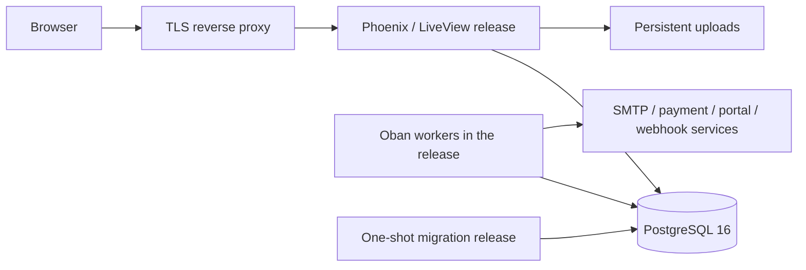

# Deployment and operations

This guide covers the repository's container/release workflow and operational data. Read [configuration](configuration.md), [database](database.md), and the [multi-business model](technical-architecture.md#multi-business-model) before upgrading an installation that holds existing data. Back up the database before the first migration that moves existing tables into `biz_1`.

## Deployment shape



The reverse proxy is an external deployment component; Compose does not configure it. HTTP is published on port 4000. Production URLs use HTTPS/port 443, and `force_ssl` honors `x-forwarded-proto`; localhost is excluded for local Compose use.

## Docker image and services

[`Dockerfile`](../Dockerfile) builds with Elixir 1.18.3, OTP 27.3.4.8, and Debian Bookworm. It installs dependencies, compiles/builds/digests assets, copies runtime configuration, and produces an OTP release. The final image contains the release, system TLS trust, Chromium, and fonts; it runs as `nobody` without the full Elixir SDK.

[`docker-compose.yml`](../docker-compose.yml) defines:

| Service/resource | Responsibility |
| --- | --- |
| `db` | PostgreSQL 16; private container port, persistent `postgres_data` volume, readiness probe |
| `migrate` | One-shot `bin/migrate`; waits for database health and migrates public/business schemas |
| `app` | `bin/server`; waits for successful migration and publishes `4000:4000` |
| `uploads` | Company logo uploads under the release's `priv/static/uploads` |

The uploads mount includes application version `0.1.0`; update the mount path when bumping the release version. No Redis, proxy, object store, or separate worker service is configured. Each running app release supervises its own Oban instance.

### Configure and validate

Set `DATABASE_USER`, `DATABASE_PASSWORD`, `SECRET_KEY_BASE`, `TOTP_ENCRYPTION_KEY`, and `SECRETS_ENCRYPTION_KEY`, along with `PHX_HOST` and required provider settings, in the deployment environment or local Compose `.env`.

```bash
docker compose config --quiet
docker compose up --build
docker compose ps
```

The quiet configuration check avoids printing resolved credentials. `.env` is excluded from image builds. Compose interpolation only forwards listed variables; see the configuration guide for optional keys missing from its mapping.

## Native OTP release

From a configured build environment:

```bash
mix deps.get --only prod
MIX_ENV=prod mix assets.deploy
MIX_ENV=prod mix release
```

The release is created under `_build/prod/rel/quantum_billing`. Provide production environment variables to the release process, including a full `DATABASE_URL` and the three required keys.

Run migrations with the built release entrypoint, then start it:

```bash
_build/prod/rel/quantum_billing/bin/migrate
_build/prod/rel/quantum_billing/bin/server
```

`bin/server` sets `PHX_SERVER=true`; `bin/migrate` evaluates `QuantumBilling.Release.migrate()`. Both come from [`rel/overlays/bin`](../rel/overlays/bin). A release seed operation is optional and separate; see [seeding](getting-started.md#optional-seeding).

## Migration and upgrade process

1. Back up the whole PostgreSQL database, uploaded files, and the environment/key material needed to decrypt stored values.
2. Build the intended application revision and check its migration changes.
3. Run the migration entrypoint once against the target database. Public migrations run first; every business schema is then migrated, archived businesses included.
4. Start the matching application revision and inspect health, logs, representative workflows, and queue failures.

The schema-transfer migration moves thirteen business tables to `biz_1`, creates shared business/membership/security records, and marks its baseline applied. New businesses are built by the tenant migrations, starting with the tenant baseline. `pg_trgm` must be available for the baseline's trigram index operator class.

`mix ecto.rollback` and `QuantumBilling.Release.rollback/2` address public migrations; there is no coordinated rollback of every business schema. The schema-transfer migration's `down` path rejects rollback when more than one business exists. A database migration changing monetary units or data ownership needs a considered recovery plan; an older release may not understand the resulting schema.

Do not use `mix ecto.reset` or `docker compose down -v` as an upgrade procedure. They delete data.

## Health and logs

```bash
curl --fail http://localhost:4000/health
docker compose logs --tail=100 app migrate
```

`GET /health` uses the API pipeline, runs `SELECT 1` with a two-second timeout, and returns status/database/version JSON. It answers 503 when the database is unavailable. It verifies connectivity, not completed business workflows, external providers, queue drainage, or every schema's migration state.

Development offers `/dev/dashboard` and `/dev/mailbox`; production disables these routes. Request logs include request IDs. `SlowQueryLogger` logs queries exceeding `SLOW_QUERY_MS` with query-source/timing information. Review provider errors and job states when asynchronous actions do not finish.

## Background jobs and retention

Queues share the Repo connection pool with web requests:

| Queue | Configured concurrency | Work |
| --- | --- | --- |
| `default` | 10 | E-invoice work and general jobs |
| `mailers` | 5 | Document construction and mail delivery |
| `recurring` | 5 | Recurring invoice generation |
| `webhooks` | 10 | Outgoing endpoint delivery |
| `maintenance` | 2 | Retention and compliance reminders |

Cron is evaluated in UTC:

| UTC schedule | Job |
| --- | --- |
| Daily 01:30 | Recurring billing sweep |
| Daily 02:00 | Audit/delivery/webhook retention |
| Daily 02:30 | Compliance reminder sweep |
| Weekly | Oban job-table reindexing |

Oban leader election coordinates Cron across nodes. The pruner removes completed job history after seven days; Lifeline rescues jobs stuck executing after 30 minutes. Audit retention comes from settings, and email/webhook ledger retention is 90 days in the maintenance worker. See individual worker modules for retry/backoff and uniqueness rules.

Inspect state without dumping job arguments, which may contain identifiers or operational data:

```sql
SELECT queue, state, COUNT(*)
FROM public.oban_jobs
GROUP BY queue, state
ORDER BY queue, state;
```

Every job's `args` carries the `business_id` it runs in, so `args->>'business_id'` groups the backlog by business. Each daily cron run first inserts one sweep job, which then inserts one job per active business; expect that many maintenance/recurring jobs per run.

## Backups and recovery

### Full installation backup

Use PostgreSQL backup tooling to capture the whole database, including `public`, every `biz_<id>`, sequences, extension metadata, and queue tables. For Compose, this writes a custom-format dump to the host without printing database credentials:

```bash
docker compose exec -T db sh -c 'pg_dump -U "$POSTGRES_USER" -d "$POSTGRES_DB" -Fc' > quantum_billing.dump
```

Copy uploaded logos separately:

```bash
docker compose cp app:/app/lib/quantum_billing-0.1.0/priv/static/uploads ./uploads-backup
```

Preserve the three required runtime keys and provider configuration in the deployment's secret-management/backup process. A database dump without the corresponding encryption keys cannot recover encrypted fields. Treat dumps and copies as sensitive installation data and keep them out of Git.

Restore into an isolated PostgreSQL database with compatible extensions, restore uploads, configure the matching keys, and verify migration state and business data before switching traffic. PostgreSQL's `pg_restore` restores the custom-format dump. Do not point a restore experiment at an active business database.

### Application JSON export

The owner-only `/settings/backup/download` route streams a business JSON export through database cursors. Current format is 3.0; restore accepts legacy 2.0/2.1 with upgrade handling. It includes selected settings, clients, invoices/items, e-way bills/history, templates, recurring profiles, notes, and audit data.

This is a business-data portability feature, not a complete installation backup. It excludes live credentials, account/session/2FA data, upload bytes, Oban jobs, and several operational ledgers. Restore changes records in the selected business; re-enter excluded credentials separately. Sequence resynchronization qualifies the business schema explicitly. Verify authorization and round-trip behavior noted in [Business](Business.md) and [database](database.md) before relying on restore.

## Storage and scaling

The same release serves web traffic and workers. Budget pool connections across all nodes; queue concurrency does not mean every job continuously holds a connection. PDF rendering launches Chromium processes, so memory/CPU requirements depend on email/PDF throughput as well as request traffic.

Uploads currently live on local disk. Multiple app nodes need consistent persistent/shared upload storage. Rate limiting uses node-local ETS, not a distributed counter. PubSub business topics and browser-switch broadcasts need correctly connected application nodes for cross-node delivery; DNSCluster is optional discovery, not a complete deployment topology.

## Provider readiness

- Configure SMTP and sender identity for confirmations, resets, invitations, and documents; production has no development mailbox.
- Configure Razorpay credentials plus the inbound signing secret and test signature/amount/currency/idempotency behavior.
- IRP defaults to simulation; its live branch defaults to a sandbox endpoint unless configured otherwise.
- NIC e-way-bill handling can fall back to simulation on unexpected live failures. A successful application result alone does not prove portal acceptance.
- Outgoing webhook destinations pass URL/SSRF validation and can use HMAC signatures; review delivery history for retries/failures.

The [Business guide](Business.md) records product/integration limits, while [configuration](configuration.md) lists the actual switches.
