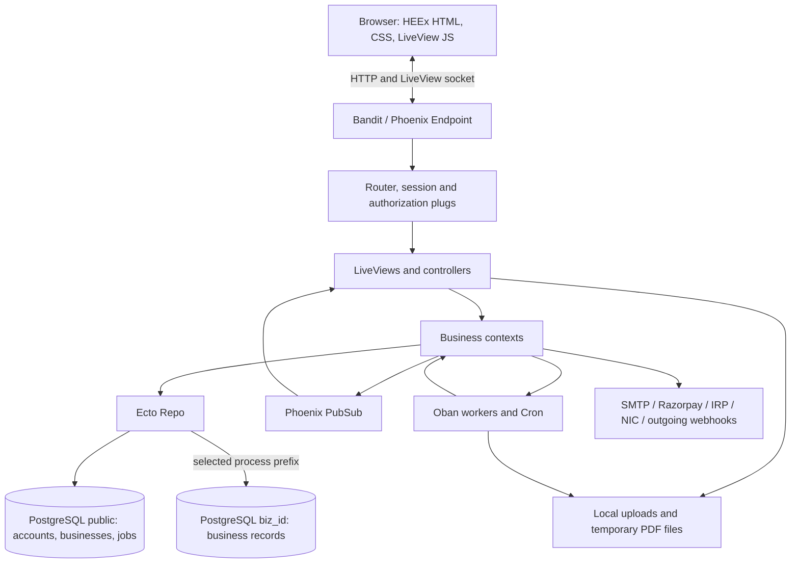

# Technical architecture

QuantumBilling is an Elixir/Phoenix application for invoicing and Indian GST-related business operations. Phoenix LiveView owns the interactive screens, context modules own business rules, Ecto talks to PostgreSQL, and Oban runs persistent background jobs. One application release contains the web server, business code, assets and job workers.

This document describes the checked-in implementation. Read [Business.md](Business.md) for the business workflows, [database.md](database.md) for tables and relationships, [tech-stack.md](tech-stack.md) for versions, and [getting-started.md](getting-started.md) for startup commands.

## Multi-business model

One installation serves several businesses, each with its books in a PostgreSQL schema of its own. Every entry point that touches business tables selects its business first; the table shows how each one does it.

| Area | Source implementation |
| --- | --- |
| Business storage | A `public.businesses` row identifies each `biz_<id>` schema. Business data lives in that schema. |
| Membership and authorization model | `Scope` carries the user, available businesses, selected business and membership; an owner is a membership role. |
| Database routing | `Repo.put_business/1` and `Repo.with_business/2` select the schema for the current process. Business queries without a selection raise `Repo.NoBusinessError`. Inside an Ecto migration, data queries follow the migration's own prefix instead. |
| HTTP and LiveView selection | `UserAuth` checks session business selection against active memberships, automatically chooses a sole membership and sets the Repo in both request and LiveView processes. The endpoint clears previous request selection. |
| Business user experience | `/businesses` lists memberships; `/businesses/new` creates a business for an existing owner; a controller POST stores a selection in the cookie and notifies other tabs. Operational routes require a selected business. |
| Background work | Workers `use QuantumBilling.Worker`: `new/2` adds the current business as `"business_id"` to the job args, and `perform/1` selects it before calling the worker's `process/1`, restoring the previous selection afterwards. A job without `"business_id"` (queued before the split) runs in business 1; one whose business no longer exists is discarded. Cron jobs are queued with no business, so sweep workers fan out one job per active business; archived businesses are skipped. |
| Public access and payment callbacks | Slug-bearing invoice/PDF links and Razorpay callback URLs select the named business. Legacy bare paths resolve to business 1. The incoming Razorpay signature secret remains installation environment configuration. |
| Real-time separation | `Events` adds the selected schema to business topics, for example `invoices:biz_2`. Account profile topics remain keyed by user. |
| Installation security policy | Browser policy and LiveView timeout checks read shared `InstallationSettings`. The Security form overlays those effective values, and saving transactionally updates the installation rules along with the business settings. |
| Backup restore sequences | Restore qualifies raw sequence/table lookup with the selected business schema, separately from Ecto's normal query prefixing. |

| Migrations | `mix ecto.migrate` (and `Release.migrate/0` in a release) runs public migrations, then the tenant migrations in `priv/repo/tenant_migrations` against every business, archived ones included. A new business is built by running every tenant migration, starting with the baseline that creates its tables. |

Starting the server or passing `/health` checks only that the endpoint and database answer. After a deployment, also confirm that the tenant migrations reached every `biz_<id>` schema (see [database.md](database.md#10-read-only-inspection-queries)).

## System layout



The schema selection in this diagram is implemented in `Repo` and established by authenticated web and public invoice/payment entry points. Independent job entry points need their own selection. There is no separate frontend API server, Redis cache, object-storage service or standalone worker deployment defined in this repository.

## Boot and OTP supervision

[`QuantumBilling.Application`](../lib/quantum_billing/application.ex) is the application entry point configured in [`mix.exs`](../mix.exs). Before starting children, it installs the transport-error log filter, attaches Oban's job logger and attaches the slow-query telemetry handler.

Its `:one_for_one` supervisor starts:

| Child | Responsibility |
| --- | --- |
| `QuantumBillingWeb.Telemetry` | Supervises a telemetry poller and defines Phoenix, Repo and VM metrics. |
| `QuantumBilling.Repo` | Maintains PostgreSQL connections and applies business schema selection. |
| `DNSCluster` | Discovers Erlang nodes when `DNS_CLUSTER_QUERY` is configured; otherwise ignored. |
| `Phoenix.PubSub`, named `QuantumBilling.PubSub` | Delivers changes to connected application processes. |
| `QuantumBilling.RateLimiter` | Owns the named ETS table used for attempt counters and expires old entries. |
| `Oban` | Runs queues and scheduled plugins against the application's Repo. |
| `QuantumBillingWeb.Endpoint` | Starts the Phoenix endpoint through the Bandit adapter when server mode is enabled. |

The supervisor restarts a failed child independently. `config_change/3` forwards release configuration changes to the endpoint. HTTP requests, LiveViews and jobs each run in processes; a process-local business selection must be established separately for each of them.

## HTTP and LiveView lifecycle

[`Endpoint`](../lib/quantum_billing_web/endpoint.ex) exposes the `/live` LiveView socket with WebSocket and long-poll transports. It serves static assets and uploads, optionally installs development reloaders, assigns request ids, emits telemetry, parses form/multipart/JSON bodies, loads the cookie session and dispatches to the router.

The JSON parser uses `RawBodyReader` to preserve raw callback bytes for signature verification. Uploaded content passes through `StaticHardening` before `Plug.Static` so its response headers can be tightened. Before router dispatch, the endpoint clears process-local business selection to prevent a keep-alive connection's previous request from carrying its schema into the next request.

For a normal browser page:

1. The `:browser` pipeline accepts HTML, fetches the session and flash, and selects the root layout.
2. CSRF protection, secure browser headers and a response-specific Content Security Policy run.
3. `fetch_current_scope_for_user` resolves the session token into `@current_scope`.
4. `fetch_current_business` checks active memberships and selects the requested business or sole available business; `EnforceSecurityPolicies` applies installation IP, idle-session and two-factor rules.
5. Authentication, business-selection and owner plugs run for scopes that declare them.
6. A controller returns a response, or a LiveView renders initial HTML and later mounts a connected socket.
7. LiveView events call contexts, changesets return validation errors, and successful changes update assigns or streams and broadcast relevant events.

[`assets/js/app.js`](../assets/js/app.js) connects `LiveSocket` with the CSRF token and compiled colocated hooks. It uses a 2.5-second long-poll fallback and a local topbar for navigation progress. The screen templates and shared components live in `lib/quantum_billing_web`; business rules live in `lib/quantum_billing`.

### Router scopes and why they exist

The following table describes the existing [`router.ex`](../lib/quantum_billing_web/router.ex); documentation changes do not add routes.

| Routes | Pipeline | Live session and hooks | Purpose |
| --- | --- | --- | --- |
| `/terms`, `/privacy`, `/p/:slug/:token`, legacy `/pay/:token` | `:browser` | `:public`, `UserAuth.mount_current_scope` | Public legal/invoice pages can render without a signed-in user. The invoice LiveView selects the slug's business, or business 1 for a legacy link, before token lookup. |
| `/p/:slug/:token/pdf`, legacy `/pay/:token/pdf` | `:browser` | Controller | A public invoice PDF/print document resolves its business before checking the bearer token. |
| `/settings/team` | `:browser`, `:require_authenticated_user`, `:require_business`, `:require_owner` | `:owner`, authenticated/business/owner hooks, `NotificationsHook` | Team administration is reserved for an owner of the selected business. |
| `/settings/backup/download` | The owner pipeline above | Controller | Downloading the business backup requires owner authorization. |
| `/`, `/dashboard`, invoices, clients, e-way bills, HSN finder, reports, compliance, recurring, bin, settings, audit logs and template design | `:browser`, `:require_authenticated_user`, `:require_business` | `:app`, authenticated/business hooks and `NotificationsHook` | Operational screens require login and business selection, and share that business's notification bell. |
| Report, GST JSON, invoice/e-way print, PDF download and e-invoice XML exports | `:browser`, `:require_authenticated_user`, `:require_business` | Controllers | Authenticated downloads use the selected business and normal HTTP responses. |
| `/users/profile`, `/users/settings`, `/users/settings/confirm-email/:token` | `:browser`, `:require_authenticated_user` | `:require_authenticated_user`, authenticated hook and `NotificationsHook` | Personal account screens require login. |
| `/users/update-password` | `:browser`, `:require_authenticated_user` | Controller | Updates the password through the authenticated session flow. |
| `/businesses`, `/businesses/new` | `:browser`, `:require_authenticated_user` | Existing `:require_authenticated_user` session and hooks | Selection must work before a business is chosen; creation also checks that the user owns an active business. |
| `/businesses/:id/switch` | `:browser`, `:require_authenticated_user` | Controller POST | Only an HTTP response can write the selected business into the session cookie. Membership is checked against the scope's active business list. |
| Registration, login, confirmation, forgot/reset password, two-factor challenge | `:browser` | `:current_user`, `mount_current_scope` | Authentication pages need a current scope when one exists and must also accept signed-out visitors. |
| Confirm, login, two-factor POST and logout | `:browser` | Controllers | Session mutations and redirects occur at the HTTP layer. |
| `/health` | `:api` | Controller | Infrastructure probes need JSON without a browser session or policy lookup. |
| `/api/webhooks/razorpay/:slug`, legacy `/api/webhooks/razorpay` | `:api` | Controller | The slug selects the business; the legacy path selects business 1. A provider cannot supply a browser session, so signature verification authenticates the callback. |
| `/dev/dashboard`, `/dev/mailbox` | `:browser`, development-only | Dashboard/forwarded plug | Local monitoring and mail preview are compile-time development routes. |
| Unknown paths | `:browser` | `PageController.not_found` | The final catch-all returns the branded 404. |

The owner and authenticated LiveView hooks repeat essential authorization at socket mount: a successful initial HTTP check does not by itself protect a later LiveView connection. Routes for specific paths such as `new`, `:id/edit` and `/settings/team` precede parameterized routes that would otherwise capture them.

### Session and identity model

`UserAuth` uses account tokens stored in PostgreSQL and an encrypted, signed cookie session with `SameSite=Lax`. Login renews the session to limit fixation, supports remember-me cookies and periodically reissues old session tokens. Logout or credential changes can disconnect associated LiveView sessions.

`Accounts.Scope` is the caller structure. Templates use `@current_scope.user`, and owner checks use `Scope.owner?/1`, which consults the selected membership. The same account can be owner in one business and staff in another; the user record itself no longer holds a global role.

The requested business id is stored in the session cookie and checked against the user's active memberships. A sole business is selected automatically. Several memberships without a valid choice lead to the picker; no memberships lead to its empty state. Switching stores the choice through a controller and sends a browser-session topic event so other operational tabs reload into the new business. Profile updates preserve the current scope's business selection.

Passwords are PBKDF2 hashes. Account settings implement TOTP enrolment, QR generation, replay-window checks, and ten hashed, single-use recovery codes. Account email confirmation, magic-link/session-token functions, reset-password functions, profile editing and invitation handling live in `Accounts` and its supporting modules.

Public invoice links use a business slug plus a random bearer token. `Businesses.from_link/1` resolves an active business by slug and maps an absent slug to the first business for compatibility. `PublicInvoiceLive` selects that business for its process before token lookup, payment actions or PubSub subscription; the public PDF controller selects it for its request. Possessing the link grants access to that invoice; it does not require business membership. Unknown slugs do not fall through to another business.

## Context boundaries

| Context or supporting module | Main responsibilities |
| --- | --- |
| `Accounts`, `Accounts.TwoFactor` | Identity, login/session tokens, confirmation/reset flows, profile, membership-backed team/invitation operations and two-factor authentication. |
| `Businesses` | Shared business catalogue, membership lookup, schema creation, tenant migration and initial settings/template creation. |
| `InstallationSettings` | Shared IP allowlist, idle-session timeout and mandatory two-factor policy model. |
| `Settings` | The selected business's organization settings, invoice defaults, numbering, integrations, notifications and preferences; bridges the Security form to installation-wide sign-in rules. |
| `Clients` | Customer records, GST/address/contact validation, search/paging and bin/restore/purge operations. |
| `Invoices` | Invoice queries, aggregates, numbering, seller/layout snapshots, line items, calculations, status changes, e-invoice queueing and bin operations. |
| `CreditNotes` | Credit note records linked to invoices and invoice adjustments used by totals and GST exports. |
| `EWayBills` | Consignment records, generation/cancellation, Part-B vehicle history, validity and bin operations. |
| `Recurring` | Recurring invoice profiles, due-profile queueing, processing and billing-run state. |
| `Reports` | Database-side filtered totals, status/tax/client/month breakdowns and streaming report rows. |
| `Compliance`, `Compliance.GSTNExporter` | Filing-calendar calculations, tracked obligations and GSTR-1 JSON assembly from recorded invoices and notes. |
| `HsnFinder` | A small compiled HSN/SAC reference and search, with no database master import. |
| `Templates` | Invoice layout storage, default selection and template lifecycle. |
| `Payments`, `Payments.RazorpayClient`, `Payments.QRCode` | Payment links, UPI QR data, payment amount/currency checks and invoice reconciliation. |
| `Mail`, `InvoiceNotifier`, `EWayBillNotifier`, `Mailer` | Queued delivery ledger, document attachment construction, SMTP selection and Swoosh delivery. |
| `Webhooks`, `Webhooks.UrlGuard` | Incoming-event deduplication, encrypted receipt records, outgoing event queueing, HMAC helpers and destination validation. |
| `Notifications`, `Audit` | Business notification feed, deduplication/read state and audit trail records. |
| `Backup` | Versioned business JSON export/restore with credential exclusions and transactional data replacement. |
| `Money`, `Money.Paise`, `GST`, `Paging`, `Uploads` | Shared money boundaries, GST validation, pagination and validated local image storage. |

Most legacy business contexts currently resolve data through the process-selected Repo rather than a scope argument. New context boundaries should follow the project convention of accepting `current_scope` and authorizing/filtering from it; changing a function signature alone does not select a PostgreSQL schema.

## Database architecture

### Shared and business schemas

The shared `public` schema contains account identities and tokens, businesses, memberships, invitations, installation security settings, Oban jobs and public migration history. Ecto schemas for shared application entities declare `@schema_prefix "public"`.

Each business schema contains its own `organization_settings`, `clients`, `invoices`, `invoice_items`, `credit_notes`, `e_way_bills`, `e_way_bill_part_b_updates`, `recurring_profiles`, `invoice_templates`, `notifications`, `email_deliveries`, `audit_logs` and `webhook_events`, plus tenant migration history. Table-local ids and invoice-number series are independent between businesses. An integer invoice id therefore requires business context to be unambiguous.

[`Repo`](../lib/quantum_billing/repo.ex) records the selected business in the calling process dictionary. `prepare_query/3` supplies a query prefix when none was provided. Write wrappers add that prefix to new business structs; loaded records retain their existing metadata prefix, and shared schemas retain `public`. `with_business/2` restores the caller's previous selection in an `after` block.

An explicit Ecto prefix can override normal routing. This is a trusted application mechanism rather than PostgreSQL row-level security: database credentials can access all of the application's schemas. Process selection must be cleared/re-established on reusable request processes and must not be assumed to carry into an Oban process or a new Task.

### Migrations and new businesses

The public migration `20261015115410_move_business_tables_into_their_own_schema.exs` creates the shared business/membership tables, moves existing business tables into `biz_1`, and turns previous account roles into business-1 membership roles. Existing records remain in place; `ALTER TABLE ... SET SCHEMA` moves their database namespace. The first business has slug `main`.

New business schemas are built from `priv/repo/tenant_migrations`, starting with the `tenant_baseline` migration. Tenant schema names must match `biz_<digits>`. The baseline cannot be rolled back. A public rollback of the initial tenancy migration also refuses to run when more than one business exists.

`Businesses.create/2` creates the catalogue row and schema, runs tenant migrations, writes initial business settings/default template and assigns the creator an owner membership. Because the migrator uses its own processes/transactions, the whole operation is not one database transaction; an exception triggers schema/row cleanup.

The `mix ecto.migrate` alias runs public migrations and then `quantum_billing.migrate_businesses`. `Release.migrate/0` performs the same order for a Mix-free release and includes archived businesses. See [database.md](database.md) and [deployment.md](deployment.md) for operational commands and migration details.

### Record and transaction rules

Invoice creation uses `Ecto.Multi` and locks the business's organization settings row with `FOR UPDATE` while allocating and advancing the invoice number. Invoice line items and numbering changes commit together. Seller details and layout XML are copied to the invoice so later company/template edits do not silently change an issued document. Draft editing can refresh its layout; issued documents retain their snapshot.

Monetary values are integer paise stored in PostgreSQL `bigint` columns. `Money.Paise` casts typed rupee values at the form/import boundary; calculated totals remain integer paise. Decimal quantities and half-up rounding avoid intermediate binary floating-point arithmetic. Grand totals round to the rupee, with the difference retained as `round_off`. Exports convert back to rupee representations at their boundary.

Clients, invoices, recurring profiles and e-way bills implement soft deletion through `deleted_at`. Active queries exclude binned records; dedicated restore/purge operations handle their lifecycle. Relationship preloads, database indexes, uniqueness constraints and integrity checks support the query and mutation paths. For example, invoice numbering and incoming-event claims rely on database constraints rather than only form validation.

## Real-time changes

[`Events`](../lib/quantum_billing/events.ex) centralizes topics and message shapes. Contexts broadcast after successful writes. Connected LiveViews subscribe to the topics they handle and refresh their streams, rows or aggregates. Settings uses `broadcast_from` where the saving window already holds its updated state.

Business topic prefixes include `clients`, `invoices`, `e_way_bills`, `settings`, `invoice_templates`, `audit_logs`, `mail` and `notifications`, each followed by the selected schema, for example `clients:biz_1`. Building a business topic without a selected business raises. Account profile topics use `user:<id>`; browser-session topics carry business-switch messages.

`NotificationsHook` runs after business selection on operational pages and attaches `handle_info` and `handle_event` hooks for the business bell. Pages such as the picker and personal profile can mount without a business and receive an empty feed. New notification payloads update the feed in memory; read-state changes reload the feed and unread count. `UserAuth` also watches the user's own profile topic to keep account details synchronized across tabs.

`LiveRefresh` limits expensive aggregate reloads during bursts: the first event reloads immediately, then events within a two-second window mark the view stale and trigger at most one subsequent reload per window. PubSub is transient delivery; PostgreSQL remains the source of truth when a page mounts or reloads.

## Background jobs and scheduling

Oban stores work in PostgreSQL. Queue concurrency is configured in [`config/config.exs`](../config/config.exs): `default: 10`, `mailers: 5`, `recurring: 5`, `webhooks: 10`, `maintenance: 2`. Web requests and workers share the Repo pool. These are per-node execution limits; connection capacity must account for all application nodes.

| Worker | Queue / attempts | Behavior |
| --- | --- | --- |
| `EInvoiceWorker` | `default` / 5 | Registers an invoice, avoids already-issued IRNs, uses a 15-minute active-job uniqueness window and quadratic minute backoff. |
| `EmailWorker` | `mailers` / 5 | Reads a queued delivery, builds an invoice/e-way document and records delivery attempts. Permanently invalid/missing documents are discarded. |
| `RecurringInvoiceWorker` | `recurring` / 3 | A sweep queues due profiles; per-profile jobs create invoices. Active jobs are unique for an hour. |
| `WebhookDispatchWorker` | `webhooks` / 6 | Posts outgoing business events with a 10-second receive timeout, validates destination, disables redirects and retries temporary failures. |
| `AuditPruneWorker` | `maintenance` / 3 | Deletes audit and operational ledger records in batches of 5,000. Audit retention uses settings; mail/webhook/read-notification retention is 90 days. |
| `ComplianceReminderWorker` | `maintenance` / 3 | Creates deduplicated deadline notifications using the enabled flag and lead-day setting. |

Cron is inserted by the Oban leader. Schedules in the source are UTC; the corresponding India times are shown for operators:

| Task | Cron | UTC | Asia/Kolkata |
| --- | --- | --- | --- |
| Recurring invoice sweep | `30 1 * * *` | 01:30 daily | 07:00 daily |
| Audit/ledger retention | `0 2 * * *` | 02:00 daily | 07:30 daily |
| Compliance reminders | `30 2 * * *` | 02:30 daily | 08:00 daily |

Other plugins prune completed jobs after seven days, rescue jobs left executing for 30 minutes, and reindex Oban weekly. Tests use Oban inline mode. The three cron entries are sweeps: Oban inserts each with no business, and the worker queues one copy per active business, so a failure in one business is retried without repeating the others. The recurring sweep then fans out again, one job per due profile, each carrying the same business.

## Documents, files and exports

### Invoice layout and PDF pipeline

Invoice layouts are XML documents rather than arbitrary executable templates. `InvoiceDoc.Layout` parses and validates them with Saxy, `Document` and `Block` hold the internal representation, `Catalog` defines available blocks, and `Renderer` creates the HEEx output. Page sizes, typography, columns, totals, seller/buyer details, logo and other blocks are represented by this vocabulary.

The template designer, previews, invoice display and print paths share the renderer. `InvoiceDocument.sample/1` supplies an unsaved fictional invoice for the template/settings preview; it does not seed customer or invoice records. The issued invoice stores its layout snapshot.

`InvoiceDoc.PDF` writes generated HTML into a temporary directory and launches headless Chromium. It discovers the executable through `PDF_CHROME_PATH`, application configuration, or common executable names. The default render timeout is 20 seconds, the output must begin with `%PDF-`, and the temporary directory is removed afterward. Chromium is launched with `--no-sandbox` for the container runtime; it renders application-generated document HTML rather than a user-supplied URL. The Docker runtime supplies Chromium and fonts.

If no PDF renderer is installed, mail attachment code can fall back to an accurately named HTML file. A PDF download requires a working renderer. E-way bills have a separate document module and reuse the PDF utility.

### Other output formats

- `EInvoice`/`EInvoice.Payload` build e-invoice JSON and XML from persisted invoice data. Saxy handles XML serialization.
- `Compliance.GSTNExporter` assembles GSTR-1 JSON sections from invoice items and credit notes, using database streaming/batched item preloads.
- Report and e-way bill controllers generate downloadable CSV data; report rows are streamed rather than loading the entire dataset at once.
- `Backup` version `3.0` streams explicit field maps in a transaction and accepts legacy `2.0`/`2.1` files through conversion. Restore replaces covered business tables transactionally in batches. It excludes credentials and does not restore users, login sessions or TOTP enrolments. It is a logical business export, not a replacement for a full PostgreSQL and upload-volume backup.
- `Uploads` stores PNG, JPEG, GIF and WebP images under `priv/static/uploads`, with a 2 MB limit, magic-byte validation and content-derived filenames. SVG uploads are rejected. Current storage is a local filesystem, not S3.

## External integrations

All application HTTP integrations use Req. Provider access is conditional on configuration and several paths intentionally support local simulation.

| Integration | Checked-in behavior and boundary |
| --- | --- |
| SMTP / Swoosh | A configured business relay can supply encrypted settings; installation environment SMTP is another delivery configuration. Account mail uses the current business or business 1 when sent before business selection. Local development defaults to mailbox preview, and tests use the Swoosh test adapter. SMTP TLS verification is enabled by default. |
| Razorpay payment links | Credentials are read from organization settings first, then environment. Development/test enable simulated payment links; production simulation requires explicit configuration. Reconciliation checks amount and currency before marking an invoice paid. |
| Razorpay incoming webhook | The JSON endpoint resolves the URL's business slug, or business 1 on the legacy path. It requires the installation `RAZORPAY_WEBHOOK_SECRET`, verifies HMAC against preserved raw bytes, limits calls by source and claims provider events in that business's receipt ledger. Stored payloads are minimized and encrypted. Missing verification configuration returns 503. |
| Outgoing webhook | `Webhooks.dispatch/2` queues business events. The worker signs the exact JSON body when a webhook secret is configured; without one, the signature header is omitted. It sends event/timestamp headers, validates destinations and refuses redirects. The receiver must implement its own validation/idempotency. |
| IRP e-invoice | `IRPClient` uses environment credentials and API URL. `IRP_SANDBOX` defaults to true, and missing credentials also select a deterministic simulated IRN/mock signed payload. The client currently implements generation, not a full portal authentication/cancellation lifecycle; production onboarding must validate the provider contract. |
| NIC e-way bill | `NICClient` implements generate, cancel and Part-B HTTP requests with environment endpoint/key. No endpoint selects simulation. Unexpected/unreachable live responses also fall back to simulation; an explicit portal error response returns an error. A generated-looking number therefore does not alone prove portal acceptance. Payload code also contains demonstration defaults. |
| HSN and compliance reference | HSN/SAC entries and deadline calculations are local source data. There is no live HSN master synchronization or GST filing-status synchronization. `Compliance.filings/0` currently returns an empty list. |

Configuration variables and their precedence are described separately in [configuration.md](configuration.md). Simulation output should be recognized as test data when validating business and compliance behavior.

## Security and operational controls

The implementation contains CSRF protection, encrypted/signed sessions, response CSP, password hashing, TOTP/recovery codes, account token revocation, IP policy checks, owner checks, attempt limiting, secure upload headers and input/file validation. CSP allows scripts from the application and a response nonce; it permits inline styles for document rendering. See the actual plugs and layouts before changing asset handling.

`Encrypted.Cipher` provides AES-256-GCM envelopes with a random IV, authentication tag and type-specific additional authenticated data. `Encrypted.Binary` covers TOTP secrets; `Encrypted.Secret` and `Encrypted.Map` cover integration secrets and receipt payloads. Keys are derived from required runtime configuration and must remain stable to decrypt stored values. A database backup without the corresponding key material cannot recover those encrypted fields.

The rate limiter is ETS-backed and local to each running BEAM node; it is not a shared cluster-wide quota. `ClientIP` trusts forwarded addresses only from configured proxies for the paths that use that helper. The payment webhook's current limiter keys directly from `conn.remote_ip`.

The Security form's IP allowlist, session timeout and mandatory two-factor values apply to the whole installation. `Settings.with_installation_rules/1` loads effective values into the form, and a security-section save updates `InstallationSettings` in the same transaction as the business settings row. Audit retention remains a business setting.

The presence of these controls describes implemented mechanisms, not an independent security assessment. Two gaps are known: the backup restore event on the Settings page has no owner check of its own (the download route does), and the incoming Razorpay signature secret is installation-wide rather than per business.

## Assets and user interface implementation

The supported application bundles are `assets/js/app.js` and `assets/css/app.css`, built into `priv/static/assets`. Tailwind v4 scans JS, CSS and web modules, plus generated colocated CSS. Heroicons are packaged locally and rendered through the shared `<.icon>` component. Fonts are self-hosted Inter WOFF2 files.

The current stylesheet also imports the existing daisyUI plugin/themes and generated component styles. Project instructions call for manually styled Tailwind components for new work; documenting that dependency does not remove its current usage. There is no required React/Vue SPA or npm build step in the application pipeline. The Mix wrappers install standalone Tailwind/esbuild executables.

LiveView's compiler runs before asset bundling because the bundles import generated `phoenix-colocated/quantum_billing` hook and CSS files. Development watchers rebuild assets, while `mix assets.deploy` minifies the two bundles and creates the Phoenix digest manifest.

## Observability, testing and deployment

`Telemetry` defines endpoint/router/socket, database query/queue/decode/idle and VM memory/run-queue measurements. The development LiveDashboard displays configured metrics. `SlowQueryLogger` logs slow SQL and separates query time from queue time; the environment threshold defaults to 500 ms. Oban's logger records job lifecycle failures, while `TransportErrorFilter` reduces noise from aborted client connections.

`GET /health` runs `SELECT 1` with a two-second timeout and returns database status plus application version, using HTTP 200 or 503. It checks database reachability, not tenant migration completeness, external integrations, a successful PDF render or business-route authorization.

Tests use ExUnit, Ecto SQL Sandbox, Phoenix connection/LiveView test helpers, LazyHTML selectors, Swoosh's test adapter and Oban inline mode. Test coverage is organized around contexts, financial rules, encryption, providers, workers, controllers, LiveViews and security behavior. `mix precommit` compiles with warnings as errors, unlocks unused dependencies, formats and runs tests. See [development.md](development.md) for the verification workflow.

The Docker build compiles a production release in an Elixir/OTP builder and copies it into a Debian runtime running as `nobody`. The runtime installs Chromium and fonts. Compose defines PostgreSQL, a one-shot migration container and the app container; the app waits for successful migrations. PostgreSQL and uploads use named volumes. No database port is published by Compose; the app publishes port 4000.

Production endpoint URLs use HTTPS, while Bandit listens on HTTP behind the deployment's TLS proxy. WebSocket forwarding, host/origin configuration, shared key material and persistent upload storage matter when adding app nodes. DNSCluster, business-scoped PubSub and Oban's leader-only cron provide building blocks for clustered operation; uploads live on local disk and need shared storage before running more than one app node. See [deployment.md](deployment.md) for release and container commands.

## Source directory map

```text
assets/                         JS/CSS entry points, local vendor helpers, TS editor config
config/                         Compile-time, environment-specific and runtime configuration
docs/                           Business, setup, database, architecture and operating guides
lib/mix/tasks/                  Tenant migration Mix task
lib/quantum_billing/             Contexts, schemas, integrations and shared business utilities
  accounts/                    Account, token, invitation, scope and two-factor modules
  businesses/                  Public business and membership schemas
  encrypted/                   Authenticated encryption and Ecto types
  invoices/                    Invoice and line-item schemas
  e_invoice/                   Payload/client modules
  e_way_bills/                  Bill, form, validity, portal and Part-B modules
  payments/                    Provider and QR support
  workers/                     Oban job implementations
lib/quantum_billing_web/         Endpoint, router, auth, controllers, components and LiveViews
  invoice_doc/                 XML layout model, renderer, stylesheet and PDF utility
  e_way_bill_doc/               E-way bill document renderer
  live/                        Operational/authentication screen modules and hooks
  plugs/                       Browser security and upload response controls
priv/repo/migrations/            Shared/public migration history and initial business split
priv/repo/tenant_migrations/     Migrations applied independently to each business schema
priv/repo/seeds.exs              Environment-configured seed account entry point
priv/static/                    Built bundles, fonts, icons and uploaded images
rel/overlays/bin/                Release server and migration commands
test/                           Context, web, worker and utility tests plus sandbox fixtures
Dockerfile                      Multi-stage production release build
docker-compose.yml              PostgreSQL, migration and application containers
mix.exs / mix.lock              Project, task aliases, dependency requirements and locked versions
.env.example                    Environment-variable template; .env is local and untracked
```
